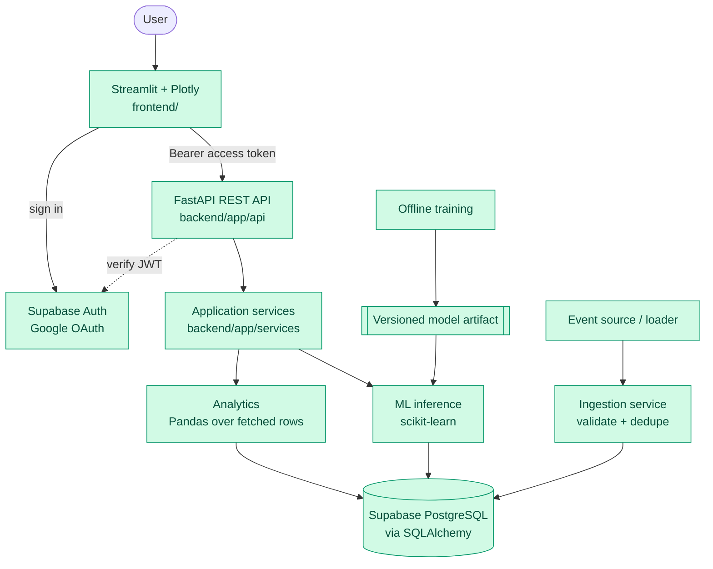
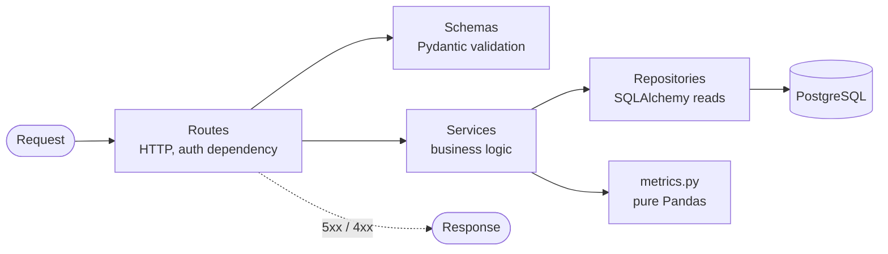

# 2. Architecture

## System context

*Green = built (all components exist as of Phase 6).*

## Architectural decisions

| # | Decision | Rationale |
|---|---|---|
| A1 | **Modular monolith**: one FastAPI app, modules for routes/services/db/ml | MVP scope; microservices are out of scope for v1 |
| A2 | **Streamlit and FastAPI are separate services** | UI never touches the DB or secrets; API is independently testable and reusable |
| A3 | **Backend-enforced ownership** (chosen) | Backend verifies the Supabase JWT and filters by `user_id` in SQLAlchemy. RLS enabled as defence-in-depth, not the primary control |
| A4 | **Training separate from inference** | API only loads a validated artifact; never retrains per request |
| A5 | **Idempotency via DB constraint** | Unique `event_id` + `ON CONFLICT DO NOTHING`; app-level check-then-insert races |
| A6 | **Two labelled datasets** (synthetic events + public churn) | No fabricated timestamps on static data |
| A7 | **Tables only as needed** | Avoid speculative schema; add Alembic when schema evolves |
| A8 | **Layered backend**: routes → services → repositories | Keeps business logic testable without HTTP/DB |

## Layers and responsibilities

| Layer | Path | Responsibility | Must not |
|---|---|---|---|
| Routes | `backend/app/api/routes/` | HTTP, auth dependency, schema validation | Contain business logic or SQL |
| Schemas | `backend/app/schemas/` | Pydantic request/response models | Touch DB |
| Services | `backend/app/services/` | Ingestion, analytics, features, prediction | Know about HTTP |
| DB | `backend/app/db/` | Models, session, repositories | Contain metric logic |
| Core | `backend/app/core/` | Config, JWT verification, logging | Hold state |
| ML | `backend/app/ml/` | `train.py`, `evaluate.py`, artifacts | Run in the request path (training) |
| Frontend | `frontend/` | Pages, API client, Plotly charts | Access DB or hold service keys |

A request moves strictly downward; lower layers never import upper ones.

## Failure behaviour `[Built]`

Built and tested: a missing or invalid model artifact returns 503 on `/churn/predict` while the rest of the API stays up; an unreachable or unconfigured database returns 503 `Database unavailable` (no connection details in the body) and `/health` stays up; a failed ingestion write is rolled back and never reported as success. Token checks (Phase 5) and the dashboard's fixed-message error states with Retry (Phase 6) are built too.

| Failure | Behaviour |
|---|---|
| Database down | API returns 503; writes never reported as successful |
| Model artifact missing/invalid | `/churn/predict` returns 503; rest of API unaffected |
| API timeout | Frontend shows "service unavailable" with Retry, never fabricated data; failures are not cached |
| Invalid/expired token | 401; no data returned |

## Scaling notes (honest limits)

Single API instance and one Postgres. Bottlenecks to measure before claiming anything: analytics queries over a large `events` table (indexes, pre-aggregation) and model inference latency. Future options: materialised views, scheduled aggregation, a worker for retraining. None are in v1.
