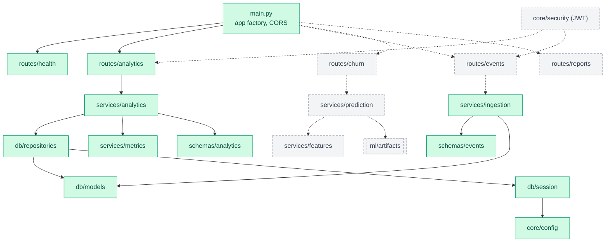
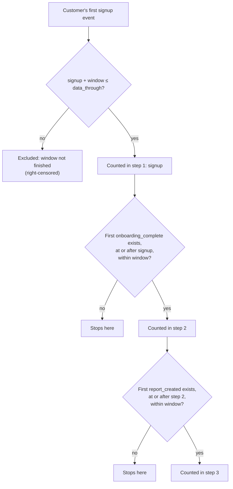
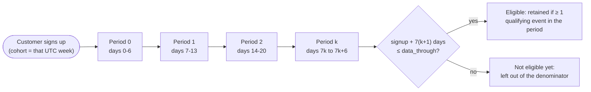
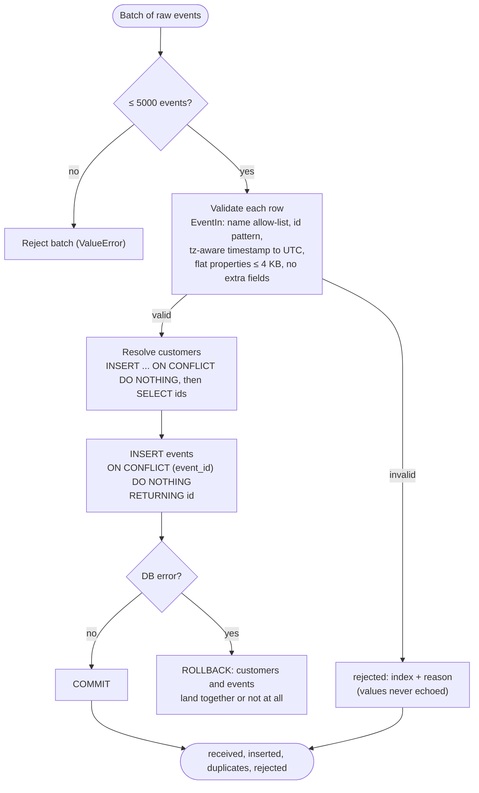
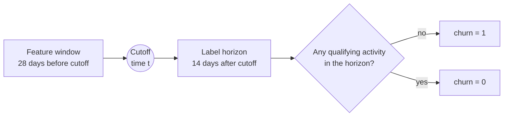
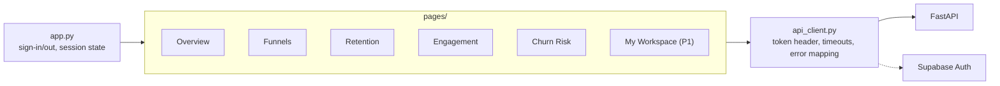

# 3. System design

## 3.1 Backend modules

```
backend/app/
├── main.py                 app factory, CORS, router mounting, error handlers
├── api/routes/             health, events, analytics, churn, reports
├── core/                   config.py · security.py (JWT) · logging.py
├── db/                     session.py · models.py · repositories.py
├── schemas/                Pydantic models
├── services/               ingestion · analytics · features · prediction
└── ml/                     train.py · evaluate.py · artifacts/
```

Start with fewer modules if needed; split when it improves clarity or testability.

Module dependencies (arrows point at what a module uses; dotted arrows are not built yet):



*Green = built, dashed grey = planned.*

## 3.2 API surface

| Method | Endpoint | Auth | Purpose | Status |
|---|---|---|---|---|
| GET | `/health` | none | Liveness (+ DB check)  `[Built]` liveness only; DB check planned |
| POST | `/events` | required | Validate and store events (batch)  `[In progress]` ingestion service built (Phase 2); HTTP route added with auth in Phase 5 |
| GET | `/analytics/overview` | required | Engagement summary  `[Built]` open until Phase 5 |
| GET | `/analytics/funnel` | required | Funnel conversion  `[Built]` open until Phase 5 |
| GET | `/analytics/retention` | required | Cohort retention  `[Built]` open until Phase 5 |
| GET | `/analytics/engagement` | required | Activity trends  `[Built]` open until Phase 5 |
| GET | `/customers/{customer_id}/insights` | required | Per-customer insights  `[Planned]` |
| POST | `/churn/predict` | required | Churn-risk estimate  `[Planned]` |
| GET/POST | `/me/reports` | required (P1) | List / save own reports  `[Planned]` |
| DELETE | `/me/reports/{id}` | required (P1) | Delete own report  `[Planned]` |

Standards: Pydantic schemas everywhere; consistent error body; validated date ranges and pagination; no stack traces; timeouts on external calls; identity derived from the token only; OpenAPI generated and reviewed. Routes may change as the project evolves.

## 3.3 Metric definitions `[Built]`

Written **before** the dashboard. Final definitions are in [Metrics](metrics.md) `[Built]`; the event allow-list is in the [data dictionary](data_dictionary.md).

| Metric | Definition |
|---|---|
| **Active users** | Distinct customers with ≥1 *qualifying* event in the window. Qualifying events are listed explicitly. |
| **Funnel conversion** | e.g. `signup → onboarding_complete → first_key_action`. Step rate = users reaching step N ÷ eligible users reaching step N‑1. Documented: event ordering, time window, user-vs-event counting, repeat handling, eligibility. |
| **Cohort retention** | Cohort = customers grouped by starting event (e.g. signup week). Retention(period k) = cohort members active in period k ÷ eligible original cohort size. Elapsed periods, not calendar; recent incomplete cohorts flagged. |
| **Engagement** | Active days per user, qualifying events per active user, feature adoption, returning-user rate, time between meaningful activities. Raw volume alone is not value. |

**Computation approach `[Built]`:** the repository fetches the needed event rows (SQL-side filter by window where possible, always excluding events after the window end) and `services/metrics.py` computes the metrics in Pandas. This is simple and hand-testable and is fine at the synthetic log's scale (~43k events), but funnel and retention read the full history on every request. If volume grows, move grouping/counting into SQL aggregations or cache results; measured latency is in the [Phase 3 log](history/phase-3-analytics/history.md). Churn feature building will also read events in bulk, offline.

All timestamps stored UTC; day/week boundaries computed in UTC and stated in the UI.

**Funnel rules** (per customer, first occurrence of each event):



**Retention periods** (elapsed since each customer's own signup, not calendar weeks). `retention = retained / eligible`; a cell with `eligible = 0` is `null` and shown as incomplete:



## 3.4 Ingestion pipeline `[Built]` (service; route pending)



In words:

1. Read source → 2. validate columns/types → 3. normalise timestamps (UTC) and IDs → 4. check missing/invalid → 5. validate event names and property types, cap payload size → 6. dedupe by `event_id` → 7. insert with `ON CONFLICT (event_id) DO NOTHING` in a transaction → 8. record rejected-row reasons (no sensitive data in logs).

Result reports `received`, `inserted`, `duplicates`, and `rejected` (index + reason; payload values are never echoed). `[Built]` as `services/ingestion.py`; the HTTP route is not built yet.

## 3.5 Churn model design

Working proposal for the label timeline (illustrative until fixed in Phase 4):



Training is offline; the API only loads a validated artifact:


- **Label** (single definition, fixed in Phase 4): inactivity — no qualifying activity in the prediction horizon (illustrative: features from prior 28 days, target over next 14 days).
- **Features** (all computable at cutoff): days since last activity · active days in window · event counts by category · activity change vs previous window · key features used · onboarding completion · account age · plan.
- **Training**: naive baseline → Logistic Regression (interpretable) → Random Forest if useful. Preprocessing fit inside a scikit-learn `Pipeline` on training data only. Time-based split on the synthetic event data.
- **Evaluation**: confusion matrix, precision, recall, F1, ROC‑AUC, class-imbalance check, naive-baseline comparison, error review. Real numbers reported in the model card.
- **Artifact**: fitted pipeline + feature schema + training metadata + `model_version` (joblib), loaded and validated at API start.
- **Public churn dataset**: used for a separate supplementary classifier; random/stratified split; no temporal claims.
- **Output**: `risk_score` presented as an uncertain estimate, never a guarantee.

## 3.6 Frontend design

```
frontend/
├── app.py            entry, sign-in/out, session state
├── api_client.py     httpx wrapper: token header, timeouts, error mapping
└── pages/            Overview · Funnels · Retention · Engagement · Churn Risk · My Workspace (P1)
```



UI rules: label date ranges and denominators; show data freshness; empty/loading/error states; no charts implying unsupported precision; never display fabricated analytics or scores.

## 3.7 Testing strategy

| Area | Key checks |
|---|---|
| Ingestion | valid accepted · invalid rejected · duplicates safe · bad timestamp/oversize rejected |
| Analytics | hand-calculated active users · funnel ordering/denominator · incomplete cohorts · empty ranges · timezone boundaries |
| Auth | missing/invalid/expired token → 401 · user A cannot read user B · client `user_id` ignored · no secrets in responses/logs |
| ML | same schema train/infer · preprocessing fit on train only · no future leakage · artifact version recorded · reproducible eval |
| Integration | DB failure ≠ success · event→analytics flow on small dataset · frontend handles API errors |
