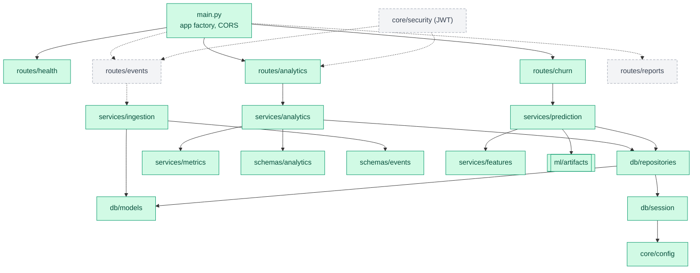
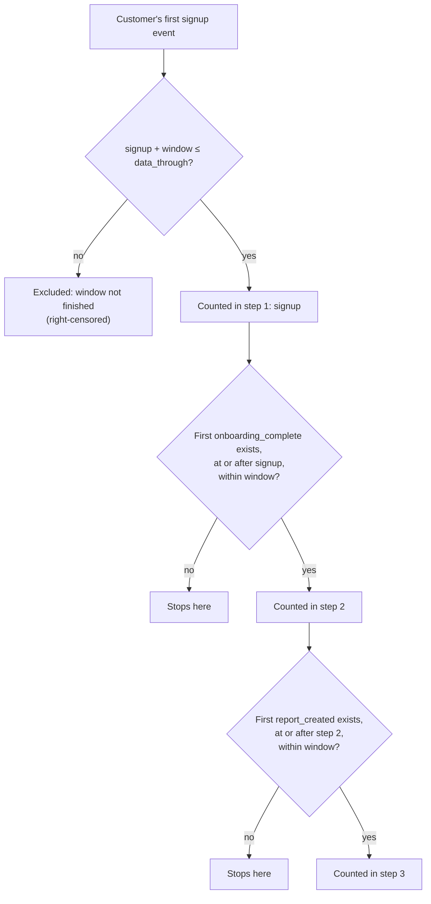
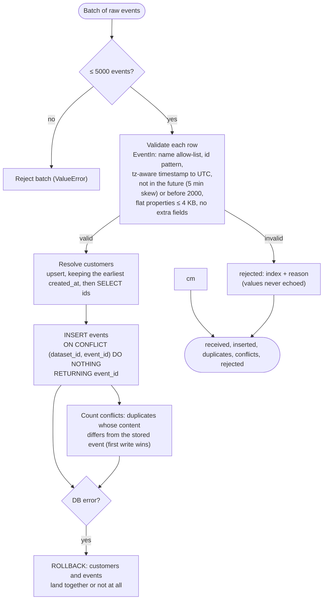
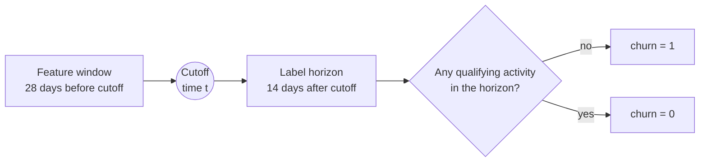
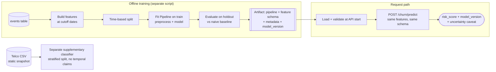
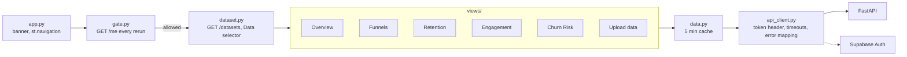

# 3. System design

## 3.1 Backend modules

```
backend/app/
├── main.py                 app factory, CORS, router mounting, error handlers
├── api/routes/             health, events, analytics, churn, reports, datasets
├── core/                   config.py · security.py (JWT) · logging.py
├── db/                     session.py · models.py · repositories.py · datasets.py (ownership)
├── schemas/                Pydantic models
├── services/               ingestion · analytics · features · prediction · uploads · upload_scoring
└── ml/                     train.py · evaluate.py · artifacts/
```

Start with fewer modules if needed; split when it improves clarity or testability.

Module dependencies (arrows point at what a module uses; dotted arrows are not built yet):



*Green = built, dashed grey = planned.*

## 3.2 API surface

| Method | Endpoint | Auth | Purpose | Status |
|---|---|---|---|---|
| GET | `/health` | none | Liveness (+ DB check)  `[Built]` liveness only; DB check planned |
| POST | `/events` | `X-API-Key` (service key) | Validate and store events (batch)  `[Built]` closed (503) unless `INGEST_API_KEY` is set; 5 MB / 5,000-event caps |
| GET | `/analytics/overview` | required | Engagement summary  `[Built]`; takes `?dataset_id=` (default 1, the demo; another user's or a missing id is 404 `Dataset not found`) |
| GET | `/analytics/funnel` | required | Funnel conversion  `[Built]` |
| GET | `/analytics/retention` | required | Cohort retention  `[Built]` |
| GET | `/analytics/engagement` | required | Activity trends  `[Built]` |
| GET | `/customers/{customer_id}/insights` | required | Per-customer insights  `[Planned]` |
| POST | `/churn/predict` | required | Churn-risk estimate for given customer ids (demo data only)  `[Built]` |
| GET | `/churn/at-risk` | required | Ranked, paged churn-risk list for all eligible customers (`sort`: `risk_desc` default, `risk_asc`, `customer_asc`; `rank` always by risk), score histogram, model evaluation  `[Built]` (Phase 6); takes `?dataset_id=`: for an upload it ranks by the method scored on that file (logistic or inactivity rule), else 409 `Churn scoring is not available for this dataset` |
| GET | `/datasets` | required | The demo dataset first, then the caller's upload: counts, `data_through`, `signup_rule`, `capabilities`, `scoring_method`  `[Built]` (Phase 6b) |
| POST | `/datasets/check` | required | Multipart `file`; parses and summarises (rows, customers, time range, event names with counts, suggested mapping, skipped rows, first-week share and the approximate-signup warning); stores nothing  `[Built]` (Phase 6b) |
| POST | `/datasets` | required | Multipart `file`, `mapping` (JSON), `derive_signup`, `acknowledge_approximate_signup`; imports as the caller's single upload, replacing the old one in one transaction, then scores it; 201, or 409 `storage_full`  `[Built]` (Phase 6b) |
| DELETE | `/datasets/{id}` | required | Delete own upload (customers and events cascade); the demo, a missing id or someone else's is 404  `[Built]` (Phase 6b) |
| POST | `/datasets/{id}/score` | required | (Re)run churn scoring on own upload; used after import and as Retry  `[Built]` (Phase 6b) |
| GET | `/me` | required | Signed-in user (id, email, created_at)  `[Built]` |
| GET/POST | `/me/reports` | required | List / save own reports (max 100)  `[Built]` |
| DELETE | `/me/reports/{id}` | required | Delete own report; 404 for missing or someone else's  `[Built]` |

Standards: Pydantic schemas everywhere; consistent error body; validated date ranges and pagination; no stack traces; timeouts on external calls; identity derived from the token only; OpenAPI generated and reviewed. Routes may change as the project evolves.

## 3.3 Metric definitions `[Built]`

Written **before** the dashboard. Final definitions are in [Metrics](metrics.md) `[Built]`; the event allow-list is in the [data dictionary](data_dictionary.md).

| Metric | Definition |
|---|---|
| **Active users** | Distinct customers with ≥1 *qualifying* event in the window. Qualifying events are listed explicitly. |
| **Funnel conversion** | e.g. `signup → onboarding_complete → first_key_action`. Step rate = users reaching step N ÷ eligible users reaching step N‑1. Documented: event ordering, time window, user-vs-event counting, repeat handling, eligibility. |
| **Cohort retention** | Cohort = customers grouped by starting event (e.g. signup week). Retention(period k) = cohort members active in period k ÷ eligible original cohort size. Elapsed periods, not calendar; recent incomplete cohorts flagged. |
| **Engagement** | Active days per user, qualifying events per active user, feature adoption, returning-user rate, time between meaningful activities. Raw volume alone is not value. |

**Computation approach `[Built]`:** the repository fetches the needed event rows (SQL-side filter by window where possible, always excluding events after the window end) and `services/metrics.py` computes the metrics in Pandas. This is simple and hand-testable and is fine at the synthetic log's scale (~43k events), but funnel and retention read the full history on every request. If volume grows, move grouping/counting into SQL aggregations or cache results; measured latency is in the [Phase 3 log](history/phase-3-analytics/history.md). Churn feature building will also read events in bulk, offline.

All timestamps stored UTC; day/week boundaries computed in UTC and stated in the UI.

**Funnel rules** (per customer, first occurrence of each event):



**Retention periods** (elapsed since each customer's own signup, not calendar weeks). `retention = retained / eligible`; a cell with `eligible = 0` is `null` and shown as incomplete:


## 3.4 Ingestion pipeline `[Built]` (service; route pending)



In words:

1. Read source → 2. validate columns/types → 3. normalise timestamps (UTC) and IDs → 4. check missing/invalid → 5. validate event names and property types, cap payload size → 6. dedupe by `event_id` → 7. insert with `ON CONFLICT (dataset_id, event_id) DO NOTHING` in a transaction → 8. record rejected-row reasons (no sensitive data in logs).

Result reports `received`, `inserted`, `duplicates` (event_id already stored or repeated in the batch), `conflicts` (duplicates whose content differs from what is stored; the stored row wins) and `rejected` (index + reason; payload values are never echoed). `[Built]` as `services/ingestion.py`; the HTTP route is not built yet.

## 3.5 Churn model design `[Built]`

Full definitions, measured results, error review and limitations: [Model card](model_card.md). Summary of what was built:

Label timeline as built:



Training is offline; the API only loads a validated artifact:




- **Label** (fixed in Phase 4): among customers active in the prior 28 days, `churn = 1` if there is no qualifying activity in the next 14 days. Weekly cutoffs; inactive customers are not scored.
- **Features** (all computable at cutoff): days since last activity · active days in window · event counts by category · activity change vs previous window · key features used · onboarding completion · account age · plan.
- **Training**: Logistic Regression ships (chosen up front); Random Forest and two naive baselines are reported for comparison. Preprocessing is fit inside a scikit-learn `Pipeline` on training rows only. Time-based split by cutoff with a 14-day purge gap on the synthetic event data.
- **Evaluation**: confusion matrix, precision, recall, F1, ROC‑AUC, class-imbalance check, naive-baseline comparison, error review. Real numbers reported in the model card.
- **Artifact**: fitted pipeline + feature schema + training metadata + `model_version` (joblib), loaded and validated at API start.
- **Public churn dataset**: used for a separate supplementary classifier; random/stratified split; no temporal claims.
- **Output**: `risk_score` presented as an uncertain estimate, never a guarantee.

## 3.6 Frontend design

```
frontend/
├── app.py            config, banner, gate, Data selector, st.navigation over six pages
├── gate.py           sign-in flow, GET /me on every rerun, stops on 403/503
├── auth.py           PKCE and token helpers (no Streamlit)
├── api_client.py     httpx wrapper: token header, timeouts, error mapping
├── dataset.py        Data selector (Demo / My data), page context, banner text, 404 fallback to demo
├── data.py           one cached (5 min) fetch per endpoint, keyed by dataset and user
├── filters.py        date sidebar, inclusive end date to API range
├── labels.py         window, freshness and percent text
├── charts.py         pure payload-to-Plotly functions
├── states.py         fixed-message error, empty and retry rendering
└── views/            overview · funnel · retention · engagement · churn · upload (My Workspace deferred)
```



`dataset.py` asks `GET /datasets` on every rerun (uncached), so a deleted or foreign dataset id falls back to the demo before any page reads the shared result cache. Upload design: [Phase 6b spec](superpowers/specs/2026-11-01-phase6b-uploads-design.md); flow: [4.5a](04-request-flows.md).

UI rules: label date ranges and denominators; show data freshness; empty/loading/error states; no charts implying unsupported precision; never display fabricated analytics or scores.

## 3.7 Testing strategy

| Area | Key checks |
|---|---|
| Ingestion | valid accepted · invalid rejected · duplicates safe · bad timestamp/oversize rejected |
| Analytics | hand-calculated active users · funnel ordering/denominator · incomplete cohorts · empty ranges · timezone boundaries |
| Auth | missing/invalid/expired token → 401 · user A cannot read user B · client `user_id` ignored · no secrets in responses/logs |
| ML | same schema train/infer · preprocessing fit on train only · no future leakage · artifact version recorded · reproducible eval |
| Integration | DB failure ≠ success · event→analytics flow on small dataset · frontend handles API errors |
