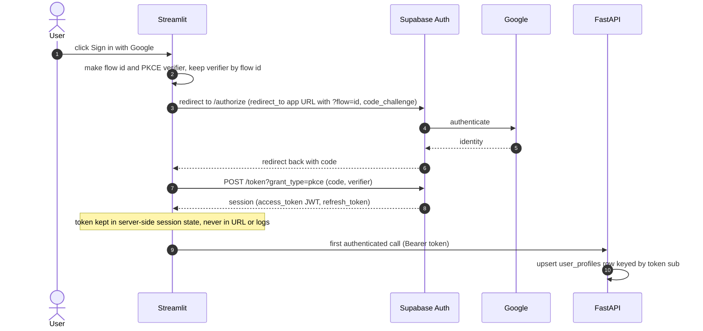
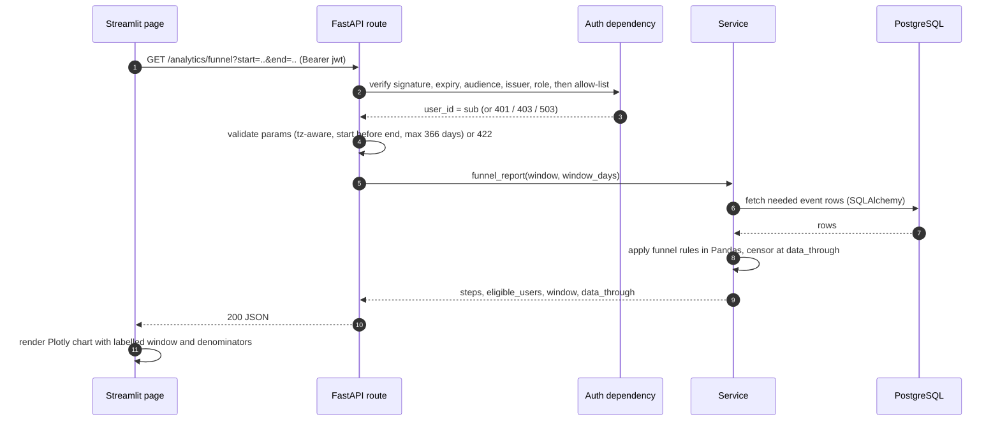
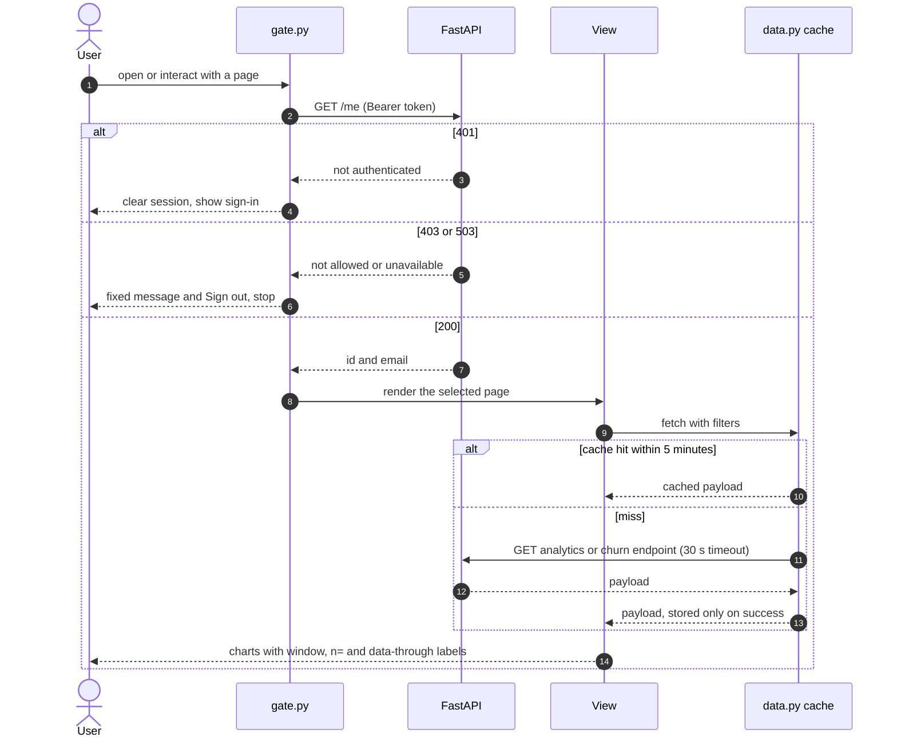
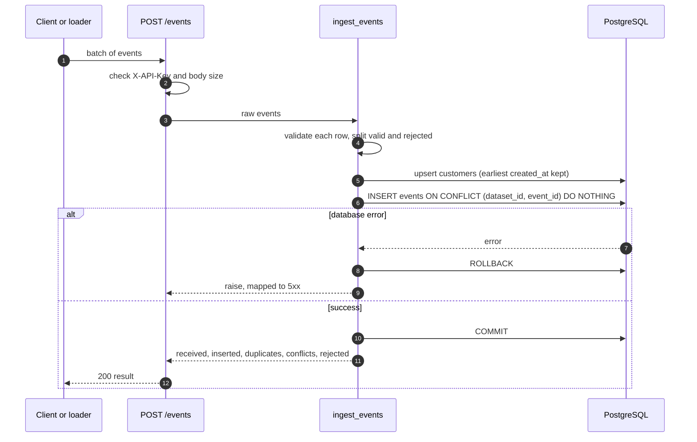
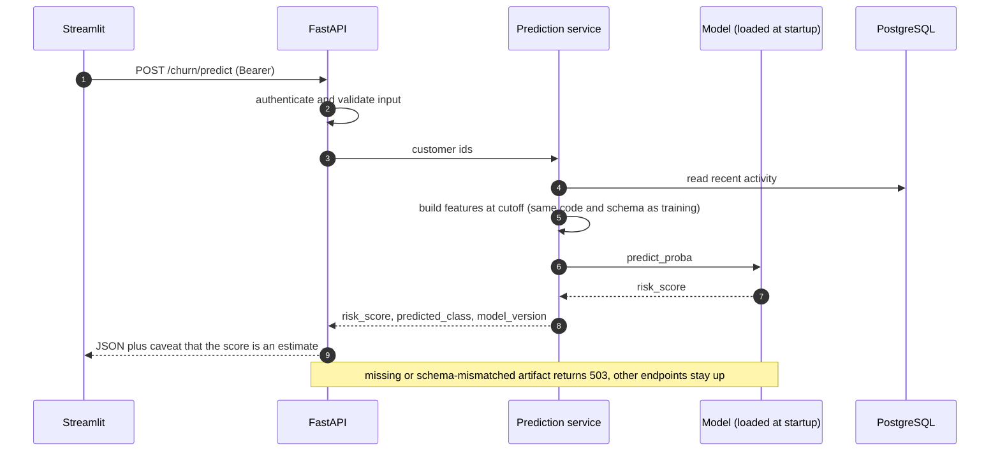
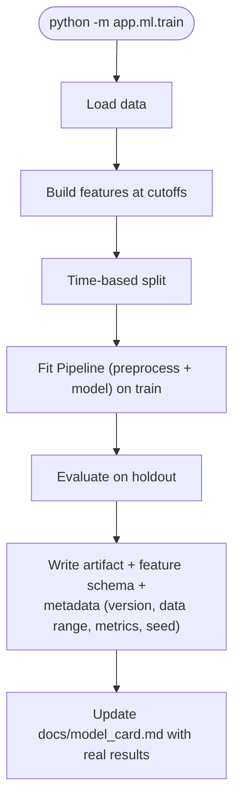
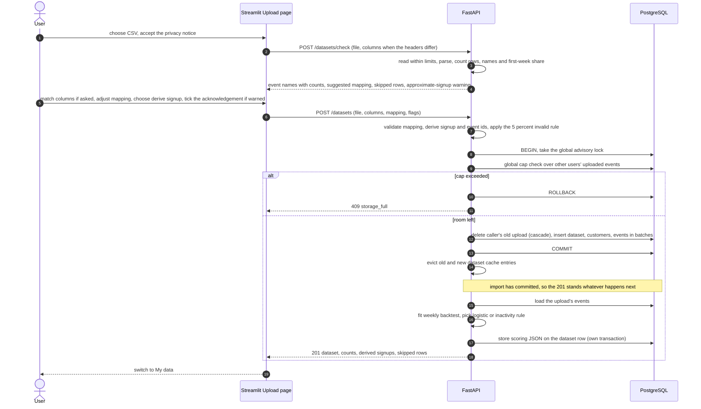

# 4. Request flows

## 4.1 Sign-in

On first authenticated API call the backend upserts a `user_profiles` row keyed by the token's `sub`.

## 4.2 Protected analytics request `[Built]`

Every analytics and churn route requires a verified, allow-listed Google user (`core/authorization.py`): no or bad token is 401, a valid token that is not on the allow-list is 403, and an unreachable key set is 503 (never "allow").

Errors: 401 bad/missing token · 403 not on the allow-list · 422 invalid params · 503 DB unavailable · timeout → UI error state.

## 4.2a Dashboard page load `[Built]` (Phase 6)

Every Streamlit rerun goes through the gate before any page runs. Cached results are shown only after the gate allows the user, so losing access (allow-list change, expired token) shows nothing even though results are cached.

Errors from a view's own fetch map to fixed messages (422 and other 4xx: invalid settings, 503 or timeout: service unavailable with Retry). Since Phase 6b the cache is keyed by dataset id and signed-in user id, and `dataset.py` re-checks `GET /datasets` on every rerun, so a deleted or foreign dataset is never read from it.

## 4.3 Event ingestion (idempotent) `[Built]`

`POST /events` always writes to dataset 1 (the demo) and is protected by a service key (`X-API-Key`, compared in constant time; the route is closed with 503 unless `INGEST_API_KEY` is set) and capped at 5 MB and 5,000 events. `scripts/load_events.py` still calls the service directly. The response is `received / inserted / duplicates / conflicts / rejected`.

Re-sending the same batch yields `inserted = 0`, `duplicates = n`. A DB failure rolls back and returns 5xx — never a success response.

## 4.4 Churn prediction `[Built]`

Implemented in `services/prediction.py` and `api/routes/churn.py`. Predictions are not persisted yet; unknown ids return `unknown_customer` and customers with no activity in the prior 28 days return `not_eligible` instead of a score.

If the artifact is missing or its feature schema mismatches: 503 with a generic message; other endpoints stay up.

## 4.4a Ranked at-risk list `[Built]` (Phase 6)

`GET /churn/at-risk?limit&offset` scores every customer with qualifying activity in the 28 days before the serving cutoff with the same feature code as `/churn/predict`, ranks them (score descending, then customer id), and returns a page plus counts, a 10-bin histogram built from the rounded scores, and the model's own test metrics from the artifact metadata. The scored list is cached in-process keyed by `(dataset_id, model_version, cutoff, max(events.id))`: the event id always grows, so a late event with an old timestamp still triggers a rescore. With `?dataset_id=` for an upload the list is ranked by that upload's own stored scoring (4.5a), keyed by `(dataset_id, scoring fitted-at, cutoff)`; the cache holds at most 4 entries and a delete, import or re-score evicts that dataset's entries.

## 4.5 Offline model training (not a request) `[Built]`

## 4.5a Upload flow `[Built]` (Phase 6b)

Four steps: check (stores nothing), map, import (one transaction), then scoring in a separate transaction after the commit. Both upload calls send the file as multipart, with the size limits enforced while the body is read (411 without Content-Length, 413 over 5.5 MB for the body or 5 MB for the file), before any parsing.

Failure behaviour: any error before the commit rolls back and the old upload stays. A scoring failure stores `scoring.method = "failed"` and the Churn Risk page offers Retry (`POST /datasets/{id}/score`). Scoring (`services/upload_scoring.py`): weekly cutoffs (latest 26), 2 test cutoffs with a purge gap so no training label overlaps the test period, logistic regression against the days-since-last-activity rule (at risk at 7 days or more); the model is used only if its PR-AUC beats the rule's by at least 0.02. Floors: at least 200 test rows and 20 churners and 20 non-churners in the test and 20 churners in training, else `rule_unchecked` (at least 28 days of history, shown as not checked on the user's data), else `unavailable`. Roughly 9 weeks of history are needed for a checked result. The fitted model is stored as JSON numbers and applied as a dot product.

## 4.6 Saved reports (P1)

`POST /me/reports` → `user_id` taken from the token (any body `user_id` is ignored) → insert. `GET`/`DELETE` filter by `user_id`; accessing another user's `report_id` returns 404 (not 403, to avoid leaking existence).
