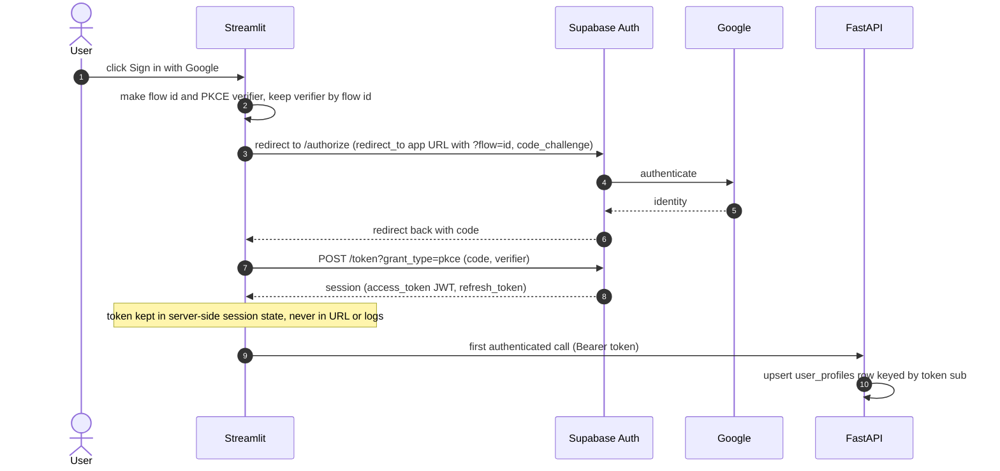
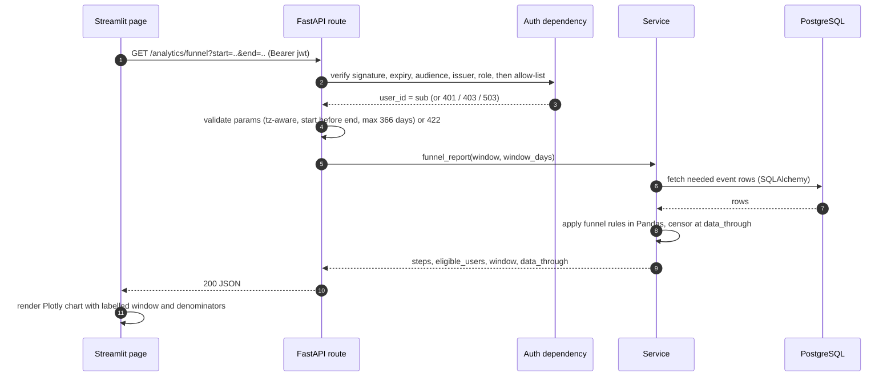
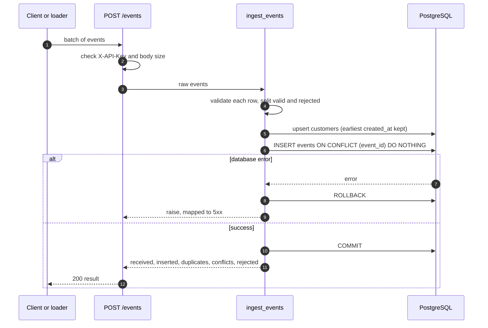
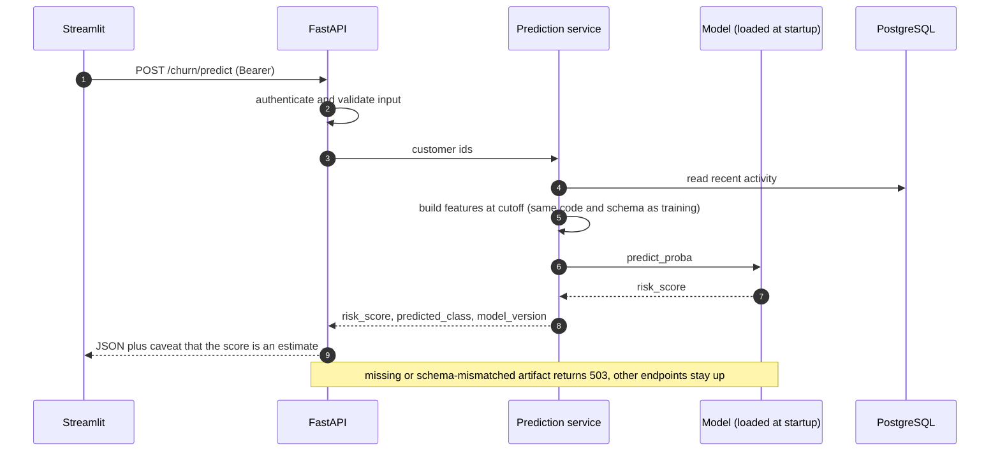

# 4. Request flows

## 4.1 Sign-in

On first authenticated API call the backend upserts a `user_profiles` row keyed by the token's `sub`.

## 4.2 Protected analytics request `[Built]`

Every analytics and churn route requires a verified, allow-listed Google user (`core/authorization.py`): no or bad token is 401, a valid token that is not on the allow-list is 403, and an unreachable key set is 503 (never "allow").

Errors: 401 bad/missing token · 403 not on the allow-list · 422 invalid params · 503 DB unavailable · timeout → UI error state.

## 4.2a Dashboard page load `[Built]` (Phase 6)

Every Streamlit rerun goes through the gate before any page runs. Cached results are shown only after the gate allows the user, so losing access (allow-list change, expired token) shows nothing even though results are cached.

```mermaid
sequenceDiagram
    autonumber
    actor U as User
    participant G as gate.py
    participant API as FastAPI
    participant V as View
    participant D as data.py cache
    U->>G: open or interact with a page
    G->>API: GET /me (Bearer token)
    alt 401
        API-->>G: not authenticated
        G-->>U: clear session, show sign-in
    else 403 or 503
        API-->>G: not allowed or unavailable
        G-->>U: fixed message and Sign out, stop
    else 200
        API-->>G: id and email
        G->>V: render the selected page
        V->>D: fetch with filters
        alt cache hit within 5 minutes
            D-->>V: cached payload
        else miss
            D->>API: GET analytics or churn endpoint (30 s timeout)
            API-->>D: payload
            D-->>V: payload, stored only on success
        end
        V-->>U: charts with window, n= and data-through labels
    end
```

Errors from a view's own fetch map to fixed messages (422 and other 4xx: invalid settings, 503 or timeout: service unavailable with Retry). The shared cache is safe only while analytics data is shared among users; Phase 6b must key it by dataset and user.

## 4.3 Event ingestion (idempotent) `[Built]`

`POST /events` is protected by a service key (`X-API-Key`, compared in constant time; the route is closed with 503 unless `INGEST_API_KEY` is set) and capped at 5 MB and 5,000 events. `scripts/load_events.py` still calls the service directly. The response is `received / inserted / duplicates / conflicts / rejected`.

Re-sending the same batch yields `inserted = 0`, `duplicates = n`. A DB failure rolls back and returns 5xx — never a success response.

## 4.4 Churn prediction `[Built]`

Implemented in `services/prediction.py` and `api/routes/churn.py`. Predictions are not persisted yet; unknown ids return `unknown_customer` and customers with no activity in the prior 28 days return `not_eligible` instead of a score.

If the artifact is missing or its feature schema mismatches: 503 with a generic message; other endpoints stay up.

## 4.4a Ranked at-risk list `[Built]` (Phase 6)

`GET /churn/at-risk?limit&offset` scores every customer with qualifying activity in the 28 days before the serving cutoff with the same feature code as `/churn/predict`, ranks them (score descending, then customer id), and returns a page plus counts, a 10-bin histogram built from the rounded scores, and the model's own test metrics from the artifact metadata. The scored list is cached in-process keyed by `(model_version, cutoff, max(events.id))`: the event id always grows, so a late event with an old timestamp still triggers a rescore.

## 4.5 Offline model training (not a request) `[Built]`

## 4.6 Saved reports (P1)

`POST /me/reports` → `user_id` taken from the token (any body `user_id` is ignored) → insert. `GET`/`DELETE` filter by `user_id`; accessing another user's `report_id` returns 404 (not 403, to avoid leaking existence).
