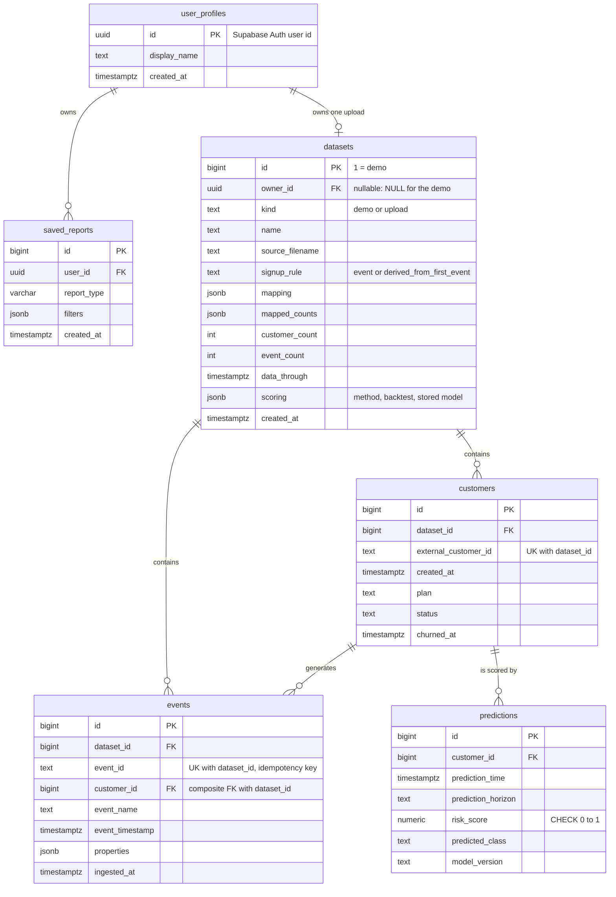

# 5. Data model

Create only the tables needed for the selected datasets and MVP. Schema is managed by Alembic once it starts evolving (`backend/migrations/`).

## 5.1 Datasets

| Dataset | Purpose | Timestamps | Notes |
|---|---|---|---|
| **Synthetic event log** | Funnels, retention, engagement, time-based churn | Yes (generated) | Produced by a documented seeded script; labelled synthetic everywhere |
| **IBM Telco Customer Churn** (public) | Supplementary classifier | No | Chosen 2026-10-23. Licence unstated by IBM; not redistributed, download instructions in `data/README.md` |

Before modelling: inspect types, missing values, duplicates, timestamps, identifiers; document how churn is labelled and all assumptions (data dictionary — finalised in Phase 1).

## 5.2 Entity relationships



`user_profiles` (people using Churnscope) are **deliberately separate** from `customers` (users of the product being analysed).

## 5.3 Tables `[Built]`

Implemented in `backend/app/db/models.py`; created by Alembic migrations `0001_initial_schema`, `0002_enable_rls` and (Phase 6b) `0003_datasets`; applied to local Postgres (Docker) and Supabase. `predictions` exists but nothing writes to it yet; `user_profiles` and `saved_reports` are used since Phase 5.

### `datasets` `[Built]` (Phase 6b, migration `0003`)
| Column | Type | Notes |
|---|---|---|
| id | bigint PK (identity) | row 1 is the demo dataset, created by the migration; the next generated id is 2 |
| owner_id | uuid FK → user_profiles, ON DELETE CASCADE | NULL for the demo |
| kind | text NOT NULL | CHECK in (`demo`, `upload`) |
| name, source_filename | text | the file name is the last path part, at most 100 characters; the original path is not kept |
| signup_rule | text NOT NULL | CHECK in (`event`, `derived_from_first_event`) |
| mapping | jsonb NOT NULL | the user's event-name mapping |
| mapped_counts | jsonb NOT NULL | rows per Churnscope event name |
| customer_count, event_count | int NOT NULL | event_count feeds the global cap |
| data_through | timestamptz | latest event |
| scoring | jsonb | method (`logistic`, `inactive_rule`, `rule_unchecked`, `unavailable`, `failed`), reason, history days, backtest numbers and the fitted model as plain numbers (no pickle); NULL until scored |
| created_at | timestamptz NOT NULL default now() | what the purge script ages by |

A partial unique index `uq_datasets_one_upload_per_owner` on `owner_id WHERE kind = 'upload'` allows at most one upload per user. RLS is on and `anon`/`authenticated` grants are revoked, as for the other tables.

### `customers`
| Column | Type | Notes |
|---|---|---|
| id | bigint PK | |
| dataset_id | bigint FK → datasets NOT NULL, ON DELETE CASCADE | existing rows backfilled to 1 |
| external_customer_id | text NOT NULL | stable source identifier; UNIQUE with `dataset_id` (`uq_customers_dataset_external`); `UNIQUE(dataset_id, id)` is the target of the events composite FK |
| created_at | timestamptz NOT NULL | signup time |
| plan | text | optional category |
| status | text | optional |
| churned_at | timestamptz | optional observed churn |

### `events`
| Column | Type | Notes |
|---|---|---|
| id | bigint PK | |
| dataset_id | bigint FK → datasets NOT NULL, ON DELETE CASCADE | existing rows backfilled to 1 |
| event_id | text NOT NULL | source-generated (or derived for uploads); idempotency key, UNIQUE with `dataset_id` (`uq_events_dataset_event_id`) |
| customer_id | bigint NOT NULL | composite FK `(dataset_id, customer_id)` → `customers(dataset_id, id)`, so an event can never point at another dataset's customer |
| event_name | text NOT NULL | validated against allow-list |
| event_timestamp | timestamptz NOT NULL | UTC |
| properties | jsonb | optional flexible attributes |
| ingested_at | timestamptz NOT NULL default now() | |

Indexes (confirm with `EXPLAIN` on real queries): unique `(dataset_id, event_id)`; `(dataset_id, customer_id, event_timestamp)`; `(dataset_id, event_name, event_timestamp)`; `(dataset_id, id)` (newest event id per dataset).

**Migration `0003_datasets`** `[Built]`: creates `datasets`, inserts the demo row, adds `dataset_id` (default 1, then no default) to `customers` and `events`, replaces the global uniques and the old indexes with the per-dataset ones above, adds the composite FK and enables RLS. Downgrade is refused while any upload exists. Size (local demo load): about 289 bytes per event and 249 per customer, indexes included, plus an estimated 30 to 40% for the new column and indexes, so the 300,000-event global cap is roughly 120 MB; re-measure on the real project before deploy.

### `user_profiles`
| Column | Type | Notes |
|---|---|---|
| id | uuid PK | Supabase Auth user id |
| display_name | text | optional |
| created_at | timestamptz NOT NULL | |

### `saved_reports` (P1)
`id` PK · `user_id` FK → user_profiles NOT NULL · `report_type` text · `filters` jsonb · `created_at` timestamptz.

### `predictions`
`id` PK · `customer_id` FK · `prediction_time` timestamptz · `prediction_horizon` interval/text · `risk_score` numeric (CHECK 0–1) · `predicted_class` · `model_version` text. Outcomes stored separately or in clearly named outcome fields — never evaluate a prediction with information known at prediction time.

## 5.4 Rules

- **RLS is on for every table** (`[Built]`, migration `0002`), with `anon`/`authenticated` grants revoked. The backend role bypasses it; the Supabase REST API roles see nothing.

- Foreign keys, uniqueness, and CHECK constraints where appropriate.
- All timestamps `timestamptz`, stored and processed in UTC.
- Private Churnscope user data separate from analysed customer data.
- JSONB for flexible event properties, not a substitute for relational columns.
- Multi-step writes in transactions.
- Idempotency enforced by the database unique constraint, not application checks.

## 5.5 Event contract (illustrative)

```json
{
  "event_id": "source-generated-unique-id",
  "customer_id": "customer-123",
  "event_name": "feature_used",
  "event_timestamp": "2026-10-20T12:30:00Z",
  "properties": { "feature": "report_builder" }
}
```

Validate identifiers, timestamps (timezone-aware), payload size, event names, and property types. The allow-list is fixed in `services/metrics.py` (`EVENT_NAMES`) and listed in [Metrics](metrics.md); it is enforced in the application, not by a database CHECK, so adding a name needs no migration.
