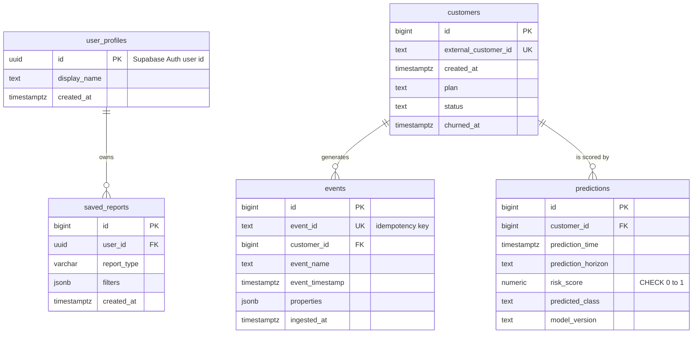

# 5. Data model

Create only the tables needed for the selected datasets and MVP. Schema is managed by Alembic once it starts evolving (`backend/migrations/`).

## 5.1 Datasets

| Dataset | Purpose | Timestamps | Notes |
|---|---|---|---|
| **Synthetic event log** | Funnels, retention, engagement, time-based churn | Yes (generated) | Produced by a documented seeded script; labelled synthetic everywhere |
| **IBM Telco Customer Churn** (public) | Supplementary classifier | No | Chosen 2026-10-23. Licence unstated by IBM; not redistributed, download instructions in `data/README.md` |

Before modelling: inspect types, missing values, duplicates, timestamps, identifiers; document how churn is labelled and all assumptions (data dictionary — finalised in Phase 1).

## 5.2 Entity relationships



`user_profiles` (people using Churnscope) are **deliberately separate** from `customers` (users of the product being analysed).

## 5.3 Tables `[Built]`

Implemented in `backend/app/db/models.py`; created by Alembic migration `0001_initial_schema`; applied to local Postgres (Docker) and Supabase. `user_profiles`, `saved_reports` and `predictions` exist but nothing writes to them yet.

### `customers`
| Column | Type | Notes |
|---|---|---|
| id | bigint PK | |
| external_customer_id | text UNIQUE NOT NULL | stable source identifier |
| created_at | timestamptz NOT NULL | signup time |
| plan | text | optional category |
| status | text | optional |
| churned_at | timestamptz | optional observed churn |

### `events`
| Column | Type | Notes |
|---|---|---|
| id | bigint PK | |
| event_id | text UNIQUE NOT NULL | source-generated; idempotency key |
| customer_id | bigint FK → customers | NOT NULL |
| event_name | text NOT NULL | validated against allow-list |
| event_timestamp | timestamptz NOT NULL | UTC |
| properties | jsonb | optional flexible attributes |
| ingested_at | timestamptz NOT NULL default now() | |

Indexes (confirm with `EXPLAIN` on real queries): unique `event_id`; `(customer_id, event_timestamp)`; `(event_name, event_timestamp)`.

### `user_profiles`
| Column | Type | Notes |
|---|---|---|
| id | uuid PK | Supabase Auth user id |
| display_name | text | optional |
| created_at | timestamptz NOT NULL | |

### `saved_reports` (P1)
`id` PK · `user_id` FK → user_profiles NOT NULL · `report_type` text · `filters` jsonb · `created_at` timestamptz.

### `predictions`
`id` PK · `customer_id` FK · `prediction_time` timestamptz · `prediction_horizon` interval/text · `risk_score` numeric (CHECK 0–1) · `predicted_class` · `model_version` text. Outcomes stored separately or in clearly named outcome fields — never evaluate a prediction with information known at prediction time.

## 5.4 Rules

- **RLS is on for every table** (`[Built]`, migration `0002`), with `anon`/`authenticated` grants revoked. The backend role bypasses it; the Supabase REST API roles see nothing.

- Foreign keys, uniqueness, and CHECK constraints where appropriate.
- All timestamps `timestamptz`, stored and processed in UTC.
- Private Churnscope user data separate from analysed customer data.
- JSONB for flexible event properties, not a substitute for relational columns.
- Multi-step writes in transactions.
- Idempotency enforced by the database unique constraint, not application checks.

## 5.5 Event contract (illustrative)

```json
{
  "event_id": "source-generated-unique-id",
  "customer_id": "customer-123",
  "event_name": "feature_used",
  "event_timestamp": "2026-10-20T12:30:00Z",
  "properties": { "feature": "report_builder" }
}
```

Validate identifiers, timestamps (timezone-aware), payload size, event names, and property types. The allow-list is fixed in `services/metrics.py` (`EVENT_NAMES`) and listed in [Metrics](metrics.md); it is enforced in the application, not by a database CHECK, so adding a name needs no migration.
