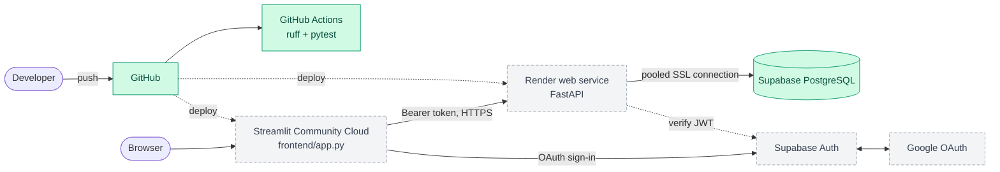

# 7. Infrastructure & deployment

> Deploy only after the local workflow is reliable (Phase 7 exit).

## 7.1 Target topology (decided)

| Component | Host | Notes |
|---|---|---|
| PostgreSQL + Auth | **Supabase** (managed) | Use the connection pooler string for the API |
| FastAPI backend | **Render** web service (free tier cold-starts; frontend must handle first-request latency) | Start: `uvicorn app.main:app --host 0.0.0.0 --port $PORT` from `backend/` |
| Streamlit frontend | **Streamlit Community Cloud** | Entry: `frontend/app.py` |
| Source | GitHub | CI via GitHub Actions |

Docker is an optional later improvement (P1), not an MVP prerequisite.

*Green = built (database and CI exist today), dashed grey = planned.*

## 7.2 Environment variables

| Variable | Service | Purpose |
|---|---|---|
| `DATABASE_URL` | backend | SQLAlchemy connection (SSL required) |
| `SUPABASE_URL` | backend, frontend | Project URL / JWKS |
| `SUPABASE_JWT_SECRET` (or JWKS) | backend | Token verification |
| `CORS_ORIGINS` | backend | Allowed dashboard origin(s) |
| `ALLOWED_EMAILS`, `ALLOWED_EMAIL_DOMAINS` | backend | Who may sign in (empty = nobody) |
| `INGEST_API_KEY` | backend | Service key for `POST /events` (unset = closed) |
| `CHURN_MODEL_SHA256` | backend | Optional pin of the model file hash |
| `APP_BASE_URL` | frontend | Dashboard origin used as the sign-in redirect |
| `API_BASE_URL` | frontend | Deployed API URL |
| `SUPABASE_ANON_KEY` | frontend | Public client key |

Per-environment values live in each host's secret store, never in Git. Streamlit uses `secrets.toml` locally (git-ignored).

## 7.3 Pre-deployment checklist

- [ ] Google OAuth redirect URLs set for local and deployed origins (Supabase + Google Cloud)
- [ ] Frontend points at deployed API URL
- [ ] CORS limited to the dashboard origin
- [ ] Secure DB connection (SSL) settings
- [ ] `/health` check configured on the host
- [ ] Secrets absent from client-visible code
- [ ] Model artifact available to the API (committed small artifact or fetched at build)
- [ ] Full sign-in → dashboard flow tested on the deployed stack

## 7.4 CI (GitHub Actions)

On push/PR (`.github/workflows/ci.yml`): `uv sync` → ruff check and format check → `pytest` in `backend/` (and ruff in `frontend/`). The backend job starts a Postgres 16 service container and sets `TEST_DATABASE_URL`; under `CI` the DB tests fail rather than skip when the database is unreachable. Tests never touch the production Supabase project. `[Built]`. First GitHub run on 2026-10-29 passed (backend with the Postgres service; the frontend job now runs lint and its pytest suite).

## 7.5 Migrations

Alembic in `backend/migrations/`. Apply to staging before production; schema changes are backwards-compatible with the running API version where possible.

## 7.6 Environments

| Env | DB | Purpose |
|---|---|---|
| local | local Postgres or a dev Supabase project | development, tests |
| prod | Supabase project | portfolio demo (synthetic data only) |
