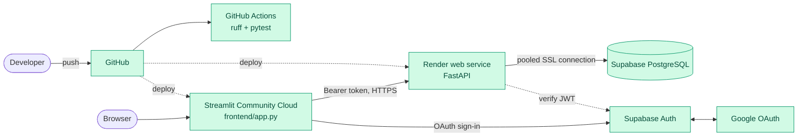

# 7. Infrastructure & deployment

> Deployed in Phase 7b (first live 2026-11-06). Sections 7.1 to 7.6 are the design; 7.7 is the setup as built, with the gotchas hit on the way; 7.8 is the live check list.

## 7.1 Target topology (decided)

| Component | Host | Notes |
|---|---|---|
| PostgreSQL + Auth | **Supabase** (managed) | Use the connection pooler string for the API |
| FastAPI backend | **Render** web service `churnscope-api` (free tier cold-starts; the dashboard waits for it, see `API_WAKE_SECONDS`) | Root directory `backend/`. Build: `pip install uv && uv sync --frozen --no-dev`. Start: `uv run --no-sync uvicorn app.main:app --host 0.0.0.0 --port $PORT` (a bare `uvicorn` is not found: the packages live in `backend/.venv`, which is not on the host's PATH) |
| Streamlit frontend | **Streamlit Community Cloud** | Entry: `frontend/app.py`, branch `main`; the app runs inside a sandboxed iframe (see 7.7) |
| Source | GitHub | CI via GitHub Actions |

Docker is an optional later improvement (P1), not an MVP prerequisite.

*Green = built and running (Phase 7b).*

## 7.2 Environment variables

| Variable | Service | Purpose |
|---|---|---|
| `DATABASE_URL` | backend | SQLAlchemy connection (SSL required) |
| `SUPABASE_URL` | backend, frontend | Project URL / JWKS |
| `SUPABASE_JWT_SECRET` (or JWKS) | backend | Token verification |
| `CORS_ORIGINS` | backend | Allowed dashboard origin(s) |
| `ALLOWED_EMAILS`, `ALLOWED_EMAIL_DOMAINS` | backend | Who may sign in (empty = nobody) |
| `INGEST_API_KEY` | backend | Service key for `POST /events` (unset = closed) |
| `CHURN_MODEL_SHA256` | backend | Optional pin of the model file hash |
| `APP_BASE_URL` | frontend | Dashboard origin used as the sign-in redirect |
| `API_BASE_URL` | frontend | Deployed API URL |
| `SUPABASE_ANON_KEY` | frontend | Public client key |
| `API_WAKE_SECONDS` | frontend | Seconds to keep retrying a sleeping API (set `60` on Render's free tier: starting the server alone took about 23 s; default 0) |
| `IDLE_TIMEOUT_MINUTES` | frontend | Idle sign-out (default 30; 0 turns it off) |

Per-environment values live in each host's secret store, never in Git. Streamlit uses `secrets.toml` locally (git-ignored).

## 7.3 Pre-deployment checklist

- [x] Google OAuth redirect URLs set for local and deployed origins (Supabase list and Site URL; Google needs no change, it redirects to Supabase's own callback)
- [x] Frontend points at deployed API URL (`API_BASE_URL` in the Streamlit secrets)
- [x] CORS limited to the dashboard origin (`CORS_ORIGINS` is empty on purpose: the dashboard calls the API from Streamlit's server, not from a browser)
- [ ] Secure DB connection (SSL) settings
- [x] `/health` check configured on the host (Render health check path)
- [x] Secrets absent from client-visible code (host secret stores only; the anon key is public by design)
- [ ] Model artifact available to the API (committed small artifact; confirm on the live Churn Risk page, 7.8)
- [ ] Full sign-in → dashboard flow tested on the deployed stack (sign-in works; the page-by-page checks are in 7.8)

## 7.4 CI (GitHub Actions)

On push/PR (`.github/workflows/ci.yml`): `uv sync` → ruff check and format check → `pytest` in `backend/` (and ruff in `frontend/`). The backend job starts a Postgres 16 service container and sets `TEST_DATABASE_URL`; under `CI` the DB tests fail rather than skip when the database is unreachable. Tests never touch the production Supabase project. `[Built]`. First GitHub run on 2026-10-29 passed (backend with the Postgres service; the frontend job now runs lint and its pytest suite).

## 7.5 Migrations

Alembic in `backend/migrations/`. Apply to staging before production; schema changes are backwards-compatible with the running API version where possible.

## 7.6 Environments

| Env | DB | Purpose |
|---|---|---|
| local | local Postgres or a dev Supabase project | development, tests |
| prod | Supabase project | portfolio demo (synthetic data only) |

## 7.7 Setup as built `[Built]` (Phase 7b)

| | Value |
|---|---|
| API | `https://churnscope-e99o.onrender.com` (Render web service `churnscope-api`, free tier) |
| Dashboard | `https://churnscope-analytics.streamlit.app` (Streamlit Community Cloud, repo `yashdiwan12/Churnscope`, branch `main`, file `frontend/app.py`) |
| Sign-in | Google through Supabase, consent screen in **Testing** mode with named test users; the API also checks `ALLOWED_EMAILS` |

**Render.** Root directory `backend`. Build `pip install uv && uv sync --frozen --no-dev`. Start `uv run --no-sync uvicorn app.main:app --host 0.0.0.0 --port $PORT`. Health check path `/health`. Environment: `DATABASE_URL` (Supabase Session pooler, `postgresql+psycopg://`), `SUPABASE_URL`, `ALLOWED_EMAILS` (one comma-separated line of full addresses); `INGEST_API_KEY`, `CORS_ORIGINS` and `ALLOWED_EMAIL_DOMAINS` unset. Python was not pinned; the host used 3.14, the same as local development.

**Streamlit secrets (TOML, values in quotes, no trailing slash on URLs).** `API_BASE_URL`, `APP_BASE_URL` (exactly the dashboard address), `SUPABASE_URL`, `SUPABASE_ANON_KEY`, `API_WAKE_SECONDS = "60"`. Top-level secrets reach the app as environment variables.

**Supabase, Authentication, URL Configuration.** Redirect URLs: `https://churnscope-analytics.streamlit.app`, `https://churnscope-analytics.streamlit.app/**` and `http://localhost:8501/**`. Site URL: the dashboard address. If a return address is not on the list, Supabase silently falls back to the Site URL; with the Site URL still on `localhost` the user lands on `localhost:8501/?code=...` after Google.

**Google Cloud.** Consent screen in Testing, user type External; every person who may sign in is a **test user** and also on Render's `ALLOWED_EMAILS` (two separate lists).

**Gotchas met on the way**
- A bare `uvicorn` start command fails with `command not found` (status 127): the packages live in `backend/.venv`. Use `uv run --no-sync uvicorn ...`.
- The API has no page at `/`: `{"detail":"Not Found"}` there means it is running. Check `/health` (200) and `/me` (401 "Not authenticated").
- Streamlit Community Cloud shows the app in a sandboxed iframe. A sign-in link with `target="_self"` keeps Google's page inside the frame and Google answers 403; `target="_top"` is blocked by the sandbox and the click does nothing. The link therefore opens a **new tab** (`target="_blank"`); the pending sign-in is held on the server, so the new tab finishes the sign-in. Same-window sign-in is not possible on this host; hosting the dashboard outside an iframe (for example a second Render service) or Streamlit's built-in `st.login` would allow it and were not chosen.
- Free tiers sleep: Render after about 15 idle minutes (the first request can take a minute), Streamlit after a few idle days (a wake-up button). `API_WAKE_SECONDS` covers the first.
- Migrations are not run on deploy. Apply a new one by hand with `alembic upgrade head` against Supabase, with approval.

## 7.8 Live checks

Tick each after trying it on the live stack. Sign-in from an allow-listed test user is confirmed.

- [x] `/health` answers 200 and `/me` answers 401 without a token
- [x] Google sign-in from a test user reaches the dashboard
- [ ] A signed-in account that is not on `ALLOWED_EMAILS` sees "not allowed"
- [ ] A cold start (API asleep) shows "Waking up the service…" and then loads
- [ ] All five pages load with data (Overview, Funnel, Retention, Engagement, Churn Risk)
- [ ] Upload a trial CSV on Data & Uploads, see the pages change, then delete it
- [ ] Idle sign-out after `IDLE_TIMEOUT_MINUTES` returns to the sign-in page

## 7.9 Keep the API awake `[Optional]`

Render's free tier stops the API after about 15 minutes without outside traffic; its own health checks do not count. An external monitor that calls `/health` every few minutes keeps it awake, so a visitor does not wait for a cold start. Nothing in the repo does this; it is set up on the monitor's website.

1. Sign up at a free monitor such as UptimeRobot (or cron-job.org).
2. Add a monitor of type HTTP(s) for `https://churnscope-e99o.onrender.com/health`, interval 5 minutes (the shortest the free plan allows), keyword or status check "200".
3. Optional: turn on the email alert, which also tells you when the API is really down.
4. After 20 minutes, open the dashboard: the first load should not show "Waking up the service…".

Notes: `/health` is public and returns no data, so the monitor needs no secret. One service awake all month is about 744 of Render's 750 free instance hours. This does not keep the Streamlit app awake (it sleeps after a few idle days; its wake-up button restores it). Status: set up 2026-11-11 (UptimeRobot, 5-minute HTTP(s) check on `/health`): [x]
