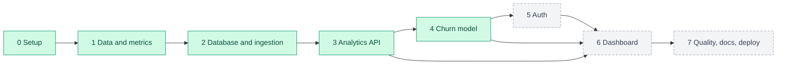

# 10. Project history

Each phase maps to a milestone in [PLAN.md](../PLAN.md) and has its own log in `docs/history/<phase>/history.md`. Update both this table and the phase log whenever work lands.



*Green = built, dashed grey = planned.*

| Phase | Milestone | Goal | Exit criterion | Status | Log |
|---|---|---|---|---|---|
| 0 | Setup | Repo, env, scaffolding, dataset choice | Clean local setup, documented data source, no secrets in Git | Done | [log](history/phase-0-setup/history.md) |
| 1 | Data & metric definitions | Data dictionary, metric/funnel/cohort rules, hand-checked examples | Assumptions documented and reproducible | Done | [log](history/phase-1-data-and-metrics/history.md) |
| 2 | Database & ingestion | Schema, SQLAlchemy, idempotent ingestion | Repeated ingestion creates no duplicates | Done | [log](history/phase-2-database-and-ingestion/history.md) |
| 3 | Analytics | Active users, funnel, retention, engagement + API | Endpoints correct vs hand-checked examples | Done | [log](history/phase-3-analytics/history.md) |
| 4 | Churn model | Label, features, training, evaluation, inference | Reproducible eval, validated API inference | Done | [log](history/phase-4-churn-model/history.md) |
| 5 | Auth | Google OAuth, JWT verification, ownership | Cross-user access fails safely | Done | [log](history/phase-5-auth/history.md) |
| 6 | Dashboard | Streamlit pages wired to API | Core analytics flow works in UI | Done (branch `phase-6-dashboard`, merge pending) | [log](history/phase-6-dashboard/history.md) |
| 6b | Bring your own data | User uploads, dataset ownership, churn report on own data | A user sees analytics for their own file and nobody else's | Not started (design pending) | [log](history/phase-6-dashboard/history.md) |
| 7 | Quality & docs | Tests, security review, screenshots, deploy | New developer can follow README end to end | Not started | [log](history/phase-7-quality-and-docs/history.md) |

## Phase log template

```markdown
# History — <phase>
**Status:** not started | in progress | done  ·  **Dates:** start → end

## Done
- <what was implemented, with file paths>

## Decisions
- <decision> — <why>

## Results / evidence
- <test output, metrics, measured numbers — only real ones>

## Open items / follow-ups
```

## Project-level decisions

| Date | Decision |
|---|---|
| 2026-10-22 | Repo split into `backend/` and `frontend/` (PLAN's `app/` → `backend/app`, `dashboard/` → `frontend/`) |
| 2026-10-22 | Data: synthetic event log + separate public churn dataset, clearly labelled |
| 2026-10-22 | Authorization: backend-enforced ownership; RLS as defence-in-depth |
| 2026-10-22 | Deployment target: Render/Railway (API) + Streamlit Community Cloud; Supabase managed |
| 2026-10-22 | Docs describe full target design with per-section status tags |
| 2026-10-23 | Project renamed from ProductPulse to Churnscope (folder, packages, docs) |
| 2026-10-23 | Public dataset: IBM Telco Customer Churn (supplementary classifier; licence unstated, not redistributed) |
| 2026-10-23 | Tech stack finalised: Python 3.12, uv + pyproject.toml, Pandas, SQL aggregation + Pandas post-processing, psycopg 3, Alembic, PyJWT/JWKS, httpx, joblib, Ruff, GitHub Actions, Render for API |
