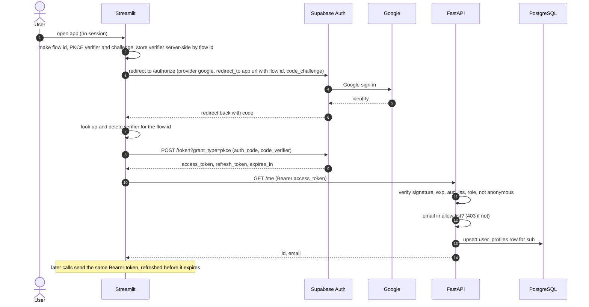

# Phase 5 design: authentication and authorization

Status: **draft for review** · Date: 2026-10-29 · Phase: 5 of 7 · Path: architectural (new subsystem, changes the public interface of every route)

## 1. Goal and non-goals

**Goal.** Only people you allow can see Churnscope's analytics and churn scores, event producers can write events without a user login, and one user can never read or change another user's private data. Identity comes from Supabase Auth (Google sign-in); authorization is enforced in the FastAPI backend.

**Done means** (from PLAN.md milestone 5): signed-in allow-listed users reach the protected routes through the Streamlit app; missing, invalid, expired, wrong-audience and wrong-user access fail safely; client-supplied identity cannot override the verified identity; the RLS/backend boundary is documented and tested.

**Non-goals:** roles or permissions beyond the allow-list; any provider other than Google; rate limiting; persisting a session across a browser reload; the analytics dashboard pages (Phase 6); deployment (Phase 7).

## 2. Understanding (what you said, and what I assumed)

Said: Google sign-in through Supabase; allow-list of accounts (chosen); `POST /events` protected by a service API key (chosen); minimal `/me/reports` so ownership is testable (chosen); RLS closed first (done, migration `0002`).

Assumed (correct me): the audience is you and a few reviewers; analytics data is shared among allowed users (it describes the analysed product's customers, not the signed-in person); reports are the only per-user private data in the MVP; a reload asking you to sign in again is acceptable.

## 3. Verified facts and what is still unverified

Checked against Supabase's docs or the auth-js source on 2026-10-29:

- PKCE: the redirect back carries a `code` query parameter; a code is valid 5 minutes and single use. Exchange is `POST {SUPABASE_URL}/auth/v1/token?grant_type=pkce` with JSON `{auth_code, code_verifier}`. Refresh is `POST .../token?grant_type=refresh_token` with `{refresh_token}`.
- Tokens: `iss` is `https://<ref>.supabase.co/auth/v1`; `aud` is `"authenticated"` for signed-in users (`"anon"` for anonymous); `sub` is the user UUID; `role`, `email`, `is_anonymous`, `aal`, `amr` (list of `{method, timestamp}`), `exp` exist.
- Keys: projects with asymmetric signing keys publish them at `{SUPABASE_URL}/auth/v1/.well-known/jwks.json` (ES256/RS256), cached by Supabase for 10 minutes. Legacy projects sign with a shared HS256 secret and publish no keys; Supabase recommends migrating to signing keys.
- Google setup: Web-application OAuth client; Supabase's callback URL as the authorized redirect URI; app origins as authorized JavaScript origins; the app's redirect URL on Supabase's redirect allow-list.

**Not documented, so not assumed.** Each is checked in the first implementation step (section 9, step 1) against a real token and a real sign-in:

1. Where `email_verified` lives (not documented) → the allow-list does **not** depend on it.
2. Exact `/authorize` query-parameter names and PKCE method casing (expected: `provider`, `redirect_to`, `code_challenge`, `code_challenge_method=s256`).
3. Whether a redirect URL with an extra query (`?flow=<id>`) matches the allow-list pattern, and the logout path/scope parameter.
4. Whether your project uses asymmetric signing keys or the legacy secret (Supabase dashboard, Project Settings, JWT Keys).
5. Claims a real Google sign-in produces: `amr`, `app_metadata.provider`, `email`.

## 4. Architecture

Components and responsibilities:

| Unit | Responsibility | Depends on |
|---|---|---|
| `core/security.py` | verify a token, return `AuthUser`; no HTTP, no DB | PyJWT, settings |
| `core/authorization.py` | allow-list check; FastAPI dependencies `current_user`, `current_profile`, `ingest_key` | security, settings, db session |
| `api/routes/me.py` | `GET /me`, `/me/reports` CRUD | dependencies, `db/reports.py` |
| `db/reports.py` | the **only** place that queries `saved_reports`; every function takes `user_id` | models |
| `api/routes/events.py` | `POST /events` | `ingest_key`, ingestion service |
| `frontend/auth.py` | PKCE flow, session state, refresh, sign-out | httpx, Streamlit |
| `frontend/api_client.py` | add Bearer token, map 401/403/503 to UI states | `frontend/auth.py` |

## 5. Backend design

### 5.1 Token verification (`core/security.py`)

- Algorithm is chosen from the token's **unverified** header, then verified against a key that matches only that algorithm:
  - `ES256` or `RS256`: key from the project's JWKS (`PyJWKClient`, 5 s timeout, keys cached at most 10 minutes).
  - `HS256`: accepted **only** if `SUPABASE_JWT_SECRET` is set, verified with that secret and nothing else.
  - anything else, including `none`: rejected. A JWKS public key is never used as an HMAC secret.
- Required and checked: `exp`, `sub` (valid UUID), `aud == "authenticated"`, `iss == {SUPABASE_URL}/auth/v1`, `role == "authenticated"`, `is_anonymous` not true. 10 s clock leeway.
- Result: `AuthUser(id: UUID, email: str | None)`. Raw tokens and claim payloads are never logged; logs carry the user id only.
- Failure mapping: bad or expired token, wrong audience/issuer/algorithm → 401 `{"detail": "Not authenticated"}` with `WWW-Authenticate: Bearer`; JWKS unreachable or auth not configured → 503 `{"detail": "Authentication unavailable"}` (fail closed, never "allow because we cannot check").
- If neither a signing key set nor a secret is configured, protected routes return 503.

### 5.2 Authorization (`core/authorization.py`)

- **Allow-list:** `ALLOWED_EMAILS` (comma-separated, compared lower-cased, exact match) and optional `ALLOWED_EMAIL_DOMAINS` (exact domain after `@`, no subdomain wildcards). An empty allow-list allows **nobody**. A token with no `email` claim is not allowed. Not allowed → 403 `{"detail": "Not allowed"}`.
- **Identity** is only ever the verified token. No route accepts a `user_id` from the client; schemas use `extra="forbid"`, so a stray `user_id` is a 422.
- **Provider assurance** (final form fixed by step 1 against a real token): the account must have signed in with Google (`amr` contains method `oauth`, and `app_metadata.provider == "google"` if the real token carries it). Supabase hardening (section 8) additionally disables email sign-ups and anonymous sign-ins so nobody can claim an allow-listed address another way.
- `current_user` (token + allow-list, no DB write) protects `/analytics/*` and `/churn/*`. `current_profile` (the same, plus `INSERT ... ON CONFLICT DO NOTHING` into `user_profiles` keyed by `sub`) protects `/me*`, because `saved_reports.user_id` is a foreign key to it.
- `/health` stays open and does not touch auth.

### 5.3 Routes

| Route | Protection | Behaviour |
|---|---|---|
| `GET /health` | none | unchanged |
| `GET /analytics/*`, `POST /churn/predict` | `current_user` | unchanged apart from 401/403/503 |
| `GET /me` | `current_profile` | `{id, email, created_at}` (email from the token) |
| `GET /me/reports` | `current_profile` | own reports, newest first, `limit` (1-100, default 50) and `offset` |
| `POST /me/reports` | `current_profile` | body `{report_type, filters}`; 201 with the created report; max 100 reports per user (409 beyond that) |
| `DELETE /me/reports/{id}` | `current_profile` | 204; **404** if the id does not exist or belongs to someone else (never 403) |
| `POST /events` | `X-API-Key` | body `{"events": [...]}`; returns the ingestion result |

- `report_type` is one of `overview`, `funnel`, `retention`, `engagement`, `churn`; `filters` is a JSON object capped at 4 KB. `user_id` is taken from the token and never from the body.
- **`POST /events`:** the key is compared in constant time (`hmac.compare_digest` over SHA-256 digests). Missing or wrong key → 401. `INGEST_API_KEY` unset → 503 `{"detail": "Ingestion is not configured"}` (the route is closed, never open by default). Body larger than 5 MB → 413; more than 5,000 events → the service's batch-size error, returned as 422. Per-row validation and rejection reasons are the Phase 2 service, unchanged; the key never appears in logs or responses.
- CORS stays restricted to the dashboard origin; `X-API-Key` is deliberately **not** an allowed browser header (producers are servers).

### 5.4 Data

No new tables. `user_profiles` and `saved_reports` already exist (migration `0001`); RLS and revoked REST-role grants are in place (migration `0002`, applied on Supabase). Ownership is enforced in `db/reports.py`, with RLS as defence in depth for anything reachable through Supabase's own API. Add an index on `saved_reports(user_id)` only if a measured query needs it.

## 6. Frontend design (`frontend/`)

- **Sign-in (PKCE).** A flow id and a PKCE verifier (high-entropy, URL-safe, 43-128 chars) are created per sign-in attempt; the challenge is the base64url SHA-256 of the verifier. The verifier is kept in a process-wide store (`st.cache_resource`) keyed by the flow id, with a 10-minute TTL, deleted on first use, capped at 1,000 entries, because a full-page redirect creates a new Streamlit session and `st.session_state` does not survive it. The flow id travels in the `redirect_to` query (`?flow=<id>`), since Supabase does not return a client `state`.
- **Return.** On load with `?code=...&flow=...`: pop the verifier, exchange the code, keep `access_token`, `refresh_token`, `expires_at` in `st.session_state`, clear the query parameters, then call `GET /me` to confirm the account is allowed.
- **Refresh and sign-out.** Refresh through `/token?grant_type=refresh_token` when the token expires within 60 s, replacing both tokens. Sign-out clears session state and calls Supabase's logout best-effort.
- **API client.** Adds `Authorization: Bearer`; on 401 clears the session and shows the sign-in page; on 403 shows "this account is not allowed" (no retry loop); on 503 shows a generic "service unavailable"; timeouts everywhere.
- **Secrets and URLs.** Only the Supabase URL and anon key are in the frontend environment; the anon key is public by design and now harmless because RLS is closed. Tokens are never put in URLs after the exchange and never logged. The frontend never calls the Supabase REST/Data API.
- **Phase 5 UI scope:** sign-in gate, "signed in as", sign-out, and a call to `/me`. The analytics pages are Phase 6.
- **Known limitations:** a browser reload loses the session (sign in again); the verifier store is per process, so a multi-process or multi-instance frontend deployment would need a shared store (Streamlit Community Cloud runs one process, so this is fine for the planned deployment).

## 7. Threats and the test that proves each mitigation

| Threat | Mitigation | Test |
|---|---|---|
| No token, malformed token | 401 | each protected route, parametrized |
| Expired token | `exp` checked | token minted already expired |
| Wrong audience or issuer | `aud`, `iss` checked | two tokens with the wrong claim |
| Forged signature | signature verified | token signed with another key |
| `alg=none` | rejected | unsigned token |
| Algorithm confusion | HS256 only with the configured secret; JWKS key never an HMAC secret | HS256 token signed with the public key's bytes |
| Anonymous or non-`authenticated` role | claims checked | `is_anonymous` and `role=anon` tokens |
| Valid token, not on allow-list | 403 | other email; empty allow-list; no email claim |
| Case/whitespace tricks in email | lower-cased exact match | `Alice@Example.com` vs list |
| Identity from the body | `extra="forbid"`; identity from token | body with `user_id` is 422 |
| User A reads or deletes user B's report | owner filter in `db/reports.py`; 404 | two users, both directions, list/delete |
| Report limit abuse | 100 per user | the 101st gets 409 |
| Ingest without or with a wrong key | 401; unset key closes the route (503) | three cases; constant-time compare used |
| Oversized event body | 413 | 5 MB + 1 |
| Auth backend down | 503, never "allow" | JWKS fetch failing |
| Secrets in responses or logs | generic bodies; no token/key logging | assertion on captured logs and response text |
| REST-API exposure of tables | RLS on, grants revoked | `tests/test_rls.py` (done) |

Tokens in tests are minted locally with generated EC and RSA keys and a test secret, and the verifier takes its key source through an injectable dependency, so no test calls Supabase.

## 8. Configuration and your one-time setup

New settings (backend): `ALLOWED_EMAILS`, `ALLOWED_EMAIL_DOMAINS` (optional), `INGEST_API_KEY`, plus the existing `SUPABASE_URL` and (legacy only) `SUPABASE_JWT_SECRET`. Frontend: `SUPABASE_URL`, `SUPABASE_ANON_KEY`, `API_BASE_URL`, `APP_BASE_URL`. All go in `.env` (git-ignored) or the host's secret store; `.env.example` gets the names only.

What you do (I give exact click-paths and verify each step with you at implementation time):

1. Google Cloud Console: create an OAuth client of type Web application; authorized JavaScript origins `http://localhost:8501`; authorized redirect URI = the callback URL shown on Supabase's Google provider page; keep the client ID and secret.
2. Supabase: enable the Google provider and paste the client ID and secret; add `http://localhost:8501/**` (pattern confirmed in step 1) to the redirect allow-list and set the Site URL.
3. Supabase hardening: disable email sign-ups and anonymous sign-ins; check Project Settings, JWT Keys to see whether the project uses signing keys (preferred) or the legacy secret.
4. Copy `SUPABASE_URL` and the anon key into `.env`; set `ALLOWED_EMAILS` to your Google address(es); generate the ingest key locally (`python -c "import secrets; print(secrets.token_urlsafe(32))"`) and set `INGEST_API_KEY`.
5. Optional extra layer: keep the Google consent screen in "Testing" mode with only your accounts as test users.

Never paste keys or secrets into this chat or commit them.

## 9. Implementation order

1. **Spike (throwaway, read-only):** one real Google sign-in through Supabase to settle the five unknowns in section 3. Update this spec with the results before building on them.
2. `core/security.py` with the full forged-token test matrix (no network).
3. `core/authorization.py`; protect analytics and churn; update existing tests to send a test token.
4. `/me` and `db/reports.py`, `/me/reports`, with the two-user isolation tests.
5. `POST /events` with the API key; ingestion route tests.
6. Frontend auth module and API client; manual end-to-end sign-in.
7. Docs: security doc boundary section, API table, request flows, diagrams, model card note; `progress.md`; phase log; update CI env if needed.

## 10. Risks and open questions

- The five unknowns in section 3; the spike removes them before code depends on them.
- A project still on the legacy HS256 secret is supported but weaker operationally (the secret can mint any token); the docs recommend moving to signing keys.
- Streamlit Community Cloud behaviour for the verifier store and query parameters is assumed from how Streamlit works and is verified in the manual end-to-end step.
- The allow-list lives in an environment variable, so adding a reviewer means a config change and restart. Acceptable for a portfolio MVP.
