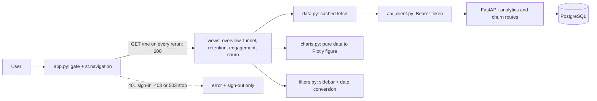

# Phase 6 design: analytics dashboard

Status: **draft for review (revised after review feedback)** · Date: 2026-10-30 · Phase: 6 of 7 (user uploads become Phase 6b) · Path: architectural (new UI subsystem, one new API endpoint, one small change to `/me`)

## 1. Goal and non-goals

**Goal.** A signed-in person completes the core analytics flow in the Streamlit app: see the overview, the funnel, cohort retention, engagement, and a ranked churn-risk list, each with its time basis, denominators and data freshness labelled, and with clear loading, empty and error states. All numbers come from the API; nothing is invented.

**Done means** (PLAN.md milestone 6, "user can complete the core analytics flow in the UI"): the five pages work against the real API and database behind Google sign-in; every page handles loading, empty, 401, 403, 422 and 503; the new endpoint's numbers are hand-checked; the pages have smoke tests; docs and `progress.md` are updated.

**Non-goals:**

- User uploads and per-user datasets: **Phase 6b**, with its own design (ownership migration, dataset-scoped queries and cache keys, CSV validation and column mapping, upload limits, a churn report on a user's own data).
- An open access mode (`ALLOW_ANY_GOOGLE_USER`) and GitHub sign-in: **Phase 7 or later**, when the Google consent screen is published or another provider is added. While it is in Testing, Google already blocks everyone who is not a listed test user, so such a flag would only save adding the same emails to `ALLOWED_EMAILS`.
- Saved views / "My Workspace" (the optional P1 item). `/me/reports` already exists and is untouched. `progress.md` records it as deferred and excludes it from the count.
- Deployment and a custom domain (Phase 7). An "event-category breakdown" (the API does not provide one, so no page shows one). Per-customer drill-down.

## 2. Understanding (what you said, and what I assumed)

Said: the dashboard shows the synthetic demo data; the Churn Risk page is a ranked at-risk list; saved views are skipped; uploads come later as their own phase; Google stays in Testing with named test users until Phase 7.

Assumed (correct me):

- **A1. Analytics data is shared.** It describes the demo product's customers, not the signed-in person, so every allowed user sees the same data and a shared cache is safe. This assumption ends with Phase 6b.
- **A2.** The audience is you, reviewers and recruiters you invite. Each test user is also added to `ALLOWED_EMAILS` (or covered by `ALLOWED_EMAIL_DOMAINS`); nothing about access control changes in this phase.
- **A3.** A short result cache (5 minutes) and a "demo data" banner on every page are acceptable.

## 3. Architecture



| Unit | Responsibility | Depends on |
|---|---|---|
| `frontend/gate.py` | the sign-in, refresh and sign-out flow moved out of `app.py`. On **every rerun** it calls `GET /me` and returns an `ApiClient` only on 200. 401 clears the session and shows sign-in; **403 and 503 render a fixed error plus a sign-out button and then `st.stop()`**, so no page content (cached or not) is shown | `auth.py`, `api_client.py` |
| `frontend/app.py` | page config, demo banner, gate, then `st.navigation([...])`; pages exist only after the gate returns | `gate.py`, `views/*` |
| `frontend/filters.py` | the sidebar controls and two pure functions: `validate_range(start: date, end: date) -> str \| None` (an error message when start is after end) and `to_api_range(start: date, end: date) -> tuple[str, str]` (UTC ISO strings: `start` at 00:00Z of the start date, `end` at 00:00Z of the **day after** the end date) | none |
| `frontend/data.py` | one function per endpoint returning plain dicts; `st.cache_data(ttl=300)`, the `ApiClient` argument excluded from the cache key; only successes are cached | `api_client.py` |
| `frontend/charts.py` | pure functions: payload in, Plotly figure or DataFrame out; no Streamlit, no network. Holds `LOW_N_MIN_ELIGIBLE = 20` | pandas, plotly |
| `frontend/states.py` | shared loading, empty and error rendering with fixed messages for 401, 403, 422 and other 4xx (`ApiError`), 503/timeout (with a Retry button) | `api_client.py` exceptions |
| `frontend/views/{overview,funnel,retention,engagement,churn}.py` | each exposes `render(api, filters)`; owns its layout and labels | `data.py`, `charts.py`, `states.py` |
| `GET /churn/at-risk` (backend) | rank every eligible customer by risk at the serving cutoff | prediction service, repositories |
| `current_profile` (backend, small change) | read the profile first and insert only when it is missing (section 5.2) | `core/authorization.py` |

Why `st.navigation`: the gate runs once in `app.py` and the pages are only reachable through it, so no page can be opened without a session and no page repeats auth code. (A `pages/` folder is auto-discovered and would need a guard per page; tabs on one page would run all five API calls on every rerun.)

**Why the shared cache does not bypass access checks.** A cache hit does not call the analytics API, so nothing there re-checks the user. What keeps this safe is the gate: it calls `/me` on every rerun and stops on 401, 403 or 503 before any view renders, so a user who loses access (removed from the allow-list, token expired) sees nothing, cached or not. A test pins this (section 8). It is safe only under assumption A1.

## 4. Frontend design

**Shared sidebar.**

- **Date range** (Overview, Funnel and Engagement only): "Latest 30 days" is on by default (the API chooses the window and returns it); turning it off shows start and end date inputs. The end date picker is **inclusive**; `to_api_range` sends the next day's midnight as the exclusive `end`, so picking 30 Oct includes all of 30 Oct. If the start date is after the end date, the sidebar shows an inline message and **no API call is made**.
- Funnel adds a conversion-window slider (1-90 days, default 14).
- **Retention has no date filter** (the API takes none); it has a periods slider (1-26, default 8).
- **Churn Risk has no date or period filter**; its cutoff is fixed by the data.

**Every page states its time basis and freshness, in the form the API supports:**

| Page | Time basis line | Freshness line |
|---|---|---|
| Overview, Funnel, Engagement | "Window: 1 Oct to 30 Oct 2026 (31 days)", from the API's `window` (the exclusive end is shown as the previous day) | "Data through DATE" from `window.data_through` |
| Retention | "Cohorts as of AS_OF" (there is no window) | "Data through AS_OF" |
| Churn Risk | "Scored at cutoff CUTOFF using the 28 days before it" (`features.WINDOW_DAYS` from the API's `window_days`) | "Data through DATA_THROUGH" (new response field) |

Next to every rate the page shows its denominator (`n=`). A banner at the top of the app says "Demo data: synthetic events from a seeded generator, not real customers."

| Page | Shows | Source |
|---|---|---|
| Overview | KPI cards (active, new, returning with rate, qualifying events); daily-active-users line; the list of qualifying event names | `/analytics/overview` |
| Funnel | step bars with user counts; conversion from previous and from start; eligible users; the API's censoring note | `/analytics/funnel` |
| Retention | cohort-by-period heatmap; incomplete cells greyed and labelled; a warning when any shown cohort is incomplete; a cell whose `eligible` is below `LOW_N_MIN_ELIGIBLE` (20) is labelled "low n" | `/analytics/retention` |
| Engagement | active days per user (mean, median), events per active user, median hours between activities, feature-adoption bars (share of active users) | `/analytics/engagement` |
| Churn Risk | model version, cutoff, window and horizon; eligible and at-risk counts; score histogram with the **decision threshold drawn as a vertical line**; ranked paged table; the API's caveat; the model's own test metrics (below) | `/churn/at-risk` |

**Low-n rule.** The unit is the **cell**: a retention cell is "low n" when its `eligible` count (the denominator of the rate shown) is below `LOW_N_MIN_ELIGIBLE = 20`. The constant lives in `charts.py` and the rule is recorded in `docs/metrics.md` as a display rule, not a metric definition.

**Model evaluation text is never hard-coded.** The API sends the shipped model's own `test_metrics` (ROC-AUC, F1, precision, recall, threshold, test churn rate, `n`) and the `synthetic` flag, taken from the artifact metadata, so the numbers always match `model_version`. The statement that the model "does not clearly beat the one-line 'inactive 7 or more days' rule" comes from the model card's baseline table, which the artifact does not carry; the frontend therefore shows it only when `model_version` equals a pinned constant `BASELINE_NOTE_FOR_VERSION` (set to the version the note was written for, `churn-lr-e330fa34d3`). For any other version the page shows the model's metrics and "Compare with the naive baselines in the model card" instead of a claim that may be stale.

**Precision and honesty.** Rates are shown to one decimal with their counts beside them. Nothing is smoothed or extrapolated. A chart is never drawn from empty data: the empty state is shown instead. Scores are labelled "risk score (relative)", never "probability".

**States** (`states.py`):

- A spinner while loading.
- An empty state ("No events in this window", with the window shown) when the API returns zero users or no cells.
- **401** clears the session and returns to sign-in (handled by the gate).
- **403** shows "This account is not allowed" and stops (gate).
- **422 and any other 4xx** (`ApiError`) show one fixed message ("Those settings are not valid. Change the filters and try again.") with no server text; the sidebar validation means this should be rare.
- **503 or a timeout** shows a generic message and a **Retry** button, with a note "Results may be up to 5 minutes old" (the frontend cache). No automatic retry loop.
- Analytics reads use a 30 s timeout (the shared client default stays 10 s) because cold database connections took 12-53 s once during startup.

## 5. Backend design

### 5.1 `GET /churn/at-risk?limit=50&offset=0`

Protected by the same `current_user` dependency as the rest of `/churn`. `limit` 1-100, `offset` 0-1,000,000 (out of range is 422). Response `AtRiskOut`:

```
model_version: str, cutoff: datetime | None, data_through: datetime | None,
window_days: int, horizon_days: int, decision_threshold: float,
eligible_customers: int, at_risk_count: int,
score_histogram: list[{bin_start: float, bin_end: float, count: int}]   # 10 equal bins over [0, 1], the last one inclusive
rows: list[{rank: int, customer_id: str, risk_score: float, predicted_class: "at_risk" | "not_at_risk"}]
evaluation: {roc_auc, f1, precision, recall, threshold, test_churn_rate, n, synthetic}   # from the artifact metadata
caveat: str
```

- **Population:** every customer with qualifying activity in the `features.WINDOW_DAYS` days before the cutoff, scored with the same feature code and column order as `/churn/predict` (`features.build_features`, the artifact's `feature_columns`). Ineligible customers are not listed.
- **Order and ranks:** `risk_score` descending, then `customer_id` ascending. Tied scores still get **distinct** 1-based ranks in that order. An `offset` beyond the end returns empty `rows`.
- **Rounding:** `risk_score` is rounded to 4 places and `predicted_class` and `at_risk_count` use the rounded value (as in `/churn/predict`). The **histogram is also built from the rounded scores**, so its bins sum to `eligible_customers` and the bins at or above the threshold sum to `at_risk_count`.
- **No events at all:** `cutoff = null`, `data_through = null`, `eligible_customers = 0`, ten zero-count bins, empty `rows`. **Model unavailable:** 503 `Churn model is unavailable`, declared before the session dependency as in `/churn/predict`.
- **Caching (must never serve stale scores):** the full scored list is cached in-process, one entry, guarded by a lock, keyed by `(model_version, cutoff, latest_event_id)`, where `latest_event_id` is `max(events.id)` from a new `repositories.latest_event_id(session)` helper. `max(event_timestamp)` is **not** used for the key: a late event carrying an older timestamp does not change it, so the list would silently go stale, whereas the auto-increment id always grows with every inserted event. (`data_through`, the max timestamp, is still returned to the client as the freshness label.)
- New code: `services/prediction.py::score_all(session, bundle, cutoff)`, `repositories.latest_event_id` and a helper mapping customer primary keys to external ids, schemas in `schemas/churn.py`.

### 5.2 `current_profile` stops writing on every call

The gate calls `GET /me` on every rerun, and `/me` depends on `current_profile`, which today runs `INSERT ... ON CONFLICT DO NOTHING` and commits on every request. Change it to `session.get(UserProfile, user.id)` first and insert (still with `ON CONFLICT DO NOTHING`, so it stays race-safe) only when the row is missing. Behaviour is unchanged; the common path becomes read-only.

### 5.3 Access

No change to access control in this phase: the Phase 5 allow-list, token checks and Google-sign-in requirement stay exactly as they are.

## 6. Configuration and your setup

- Backend and frontend: no new variables.
- Add each person who should see the dashboard as a **test user** in the Google consent screen (Audience, up to 100) **and** to `ALLOWED_EMAILS`. Publishing with a domain and privacy page, and any open-access setting, are Phase 7 tasks.

## 7. Threats and the test that proves each mitigation

| Threat | Mitigation | Test |
|---|---|---|
| Page reachable without a session | navigation built only after the gate | smoke test: no session shows sign-in and no page content |
| Cached data shown after access is lost | the gate re-checks `/me` on every rerun and stops on 401/403/503 (shared cache is safe only under assumption A1; Phase 6b must key it by dataset and user) | smoke test: a 403 from `/me` renders no page content even with cached data present |
| Stale ranked list after a late or backdated event | cache keyed on `(model_version, cutoff, max(events.id))` | insert a backdated event and assert the list is rescored |
| Last picked day silently dropped | `to_api_range` sends the next day's midnight as the exclusive end | unit test: picking 30 Oct yields an end of 31 Oct 00:00Z |
| Invalid date range reaches the API | `validate_range` blocks the call; `ApiError` has a fixed message | unit test for `validate_range`; smoke test for a 422 |
| Scores presented as probabilities, or a stale model claim | labels and caveat from the API; baseline note only for the pinned version | page tests for the caveat, and for the note shown or hidden by `model_version` |
| Wrong numbers on the ranked list | hand-checked fixture; ordering, ties, rounding/class and histogram agreement | endpoint tests on a stub-model dataset |
| Large page or offset abuse | `limit` 1-100, `offset` 0-1,000,000 | 422 tests |
| API errors shown as raw text | `states.py` maps errors to fixed messages | smoke tests for 401, 403, 422, 503 |
| A database write on every rerun | `current_profile` reads first | test counts `INSERT` statements on a repeat call: zero |

## 8. Testing

- **Backend:**
  - `/churn/at-risk` against a stub model on a hand-computed dataset: counts; histogram bins including the 0.0 and 1.0 edges; histogram sums equal `eligible_customers` and the at-risk bins equal `at_risk_count`; ordering with ties and distinct ranks; paging and offset beyond the end; rounding and class agreement; empty database; cache hit; **cache invalidation after a new event and after a backdated event**; model unavailable; 401/403/503; `limit`/`offset` bounds.
  - `current_profile`: first call inserts, second call issues no `INSERT`.
- **Frontend:**
  - `filters.py` (inclusive end picker, start after end, same-day range).
  - `charts.py` (funnel, heatmap with incomplete and low-n cells, histogram with threshold line, empty input returns nothing to draw).
  - `data.py` caches successes only.
  - Gate: a 403 or 503 from `/me` stops with no page content even when cached data exists; 401 shows sign-in.
  - Each view's smoke test with `AppTest` and a fake API returning canned payloads: time-basis and freshness lines, denominators, empty and error states; Churn Risk shows the evaluation block, and the baseline note only for the pinned model version.
- **Manual end to end with you:** sign in, visit all five pages on the real API, trigger an empty window and an error, confirm the banner and caveats.
- CI runs both suites as in Phase 5.

## 9. Implementation order and how it maps to `progress.md`

1. **Backend:** `current_profile` read-first, `latest_event_id`, `score_all`, `GET /churn/at-risk`, with tests.
2. **Frontend foundation:** `gate.py` (403/503 stop), `st.navigation` in `app.py`, `states.py`, `data.py`, `filters.py`, the `ApiClient` timeout parameter; existing frontend tests stay green. Ticks **"Connected to FastAPI"** and **"Loading, empty, error states"** once the five pages use them (end of step 8).
3. **`charts.py`** with unit tests.
4. Overview page: ticks **"Overview page"**.
5. Funnel page: ticks **"Funnel page"**.
6. Retention page: ticks **"Retention page"**.
7. Engagement page: ticks **"Engagement page"**.
8. Churn Risk page: ticks **"Churn-risk page"**, then the two foundation items above.
9. Manual end to end with you; docs (API table, request flows, metrics display rule, model card note); add Phase 6b to `progress.md`, `PLAN.md` roadmap and doc 10; mark **"Saved views" deferred** (excluded from the count, so the phase total is 7 of 7); phase log; `progress.md`.

## 10. Risks and open questions

- Funnel and retention read the full event history: about 1.7 s warm with 42,847 events, 12-53 s once on a cold database connection (hence the 30 s timeout and Retry button). Larger data is a Phase 6b/7 concern.
- The gate's `/me` call on every rerun adds one API round trip per interaction (now read-only). A short per-session cache of the access check would be faster but would delay a revoked user's lockout, so it is not used.
- The shared frontend cache is safe only under A1; Phase 6b must key every cached call by dataset and user.
- `st.navigation` and `AppTest` are used together for the first time in this project; smoke tests may need small adjustments for multipage runs.
- The ranked list rescoring all customers on every new event is quick at 2,000 customers; a much larger base would need precomputed scores (the unused `predictions` table is the natural place).
- Phase 6b (uploads) is a separate, larger design: ownership migration, dataset-scoped queries and cache keys, CSV validation and event-name mapping, size limits for the free database tier, and how to score a user's data with a model trained on synthetic data. It starts only after Phase 6 ships.
- Open question for you: whether GitHub sign-in (and the open-access setting) belongs in Phase 7 as written, or earlier.
