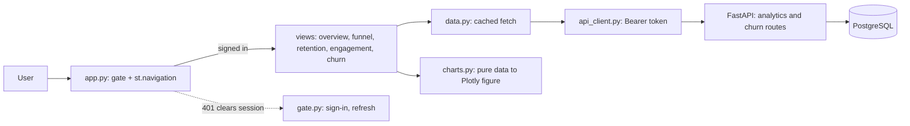

# Phase 6 design: analytics dashboard

Status: **draft for review** · Date: 2026-10-30 · Phase: 6 of 7 (user uploads become Phase 6b) · Path: architectural (new UI subsystem, one new API endpoint, one access-policy setting)

## 1. Goal and non-goals

**Goal.** A signed-in person completes the core analytics flow in the Streamlit app: see the overview, the funnel, cohort retention, engagement, and a ranked churn-risk list, each with its window, denominators and data freshness labelled, and with clear loading, empty and error states. All numbers come from the API; nothing is invented.

**Done means** (PLAN.md milestone 6, "user can complete the core analytics flow in the UI"): the five pages work against the real API and database behind Google sign-in; every page handles loading, empty, 401, 403 and 503; the new endpoint's numbers are hand-checked; the pages are covered by smoke tests; docs and `progress.md` are updated.

**Non-goals:**
- User uploads and per-user datasets: **Phase 6b**, with its own design (ownership migration, dataset-scoped queries, CSV validation and column mapping, upload limits, a churn report on a user's own data).
- Saved views / "My Workspace" (the P1 item). `/me/reports` already exists and is untouched.
- Deployment and a custom domain (Phase 7).
- An "event-category breakdown": the API does not provide one, so the page does not show one.
- Per-customer drill-down (`/customers/{id}/insights` stays planned).

## 2. Understanding (what you said, and what I assumed)

Said: any Google account may sign in (Google consent screen stays in **Testing** with named test users until Phase 7, when it is published with a domain); the dashboard shows the synthetic demo data; the Churn Risk page is a ranked at-risk list; saved views are skipped; uploads come later as their own phase.

Assumed (correct me): the audience is you, reviewers and recruiters you invite; analytics data is shared (it describes the demo product's customers, not the signed-in person); a 5-minute cache of read-only results is acceptable; a "demo data" banner on every page is wanted.

## 3. Architecture



| Unit | Responsibility | Depends on |
|---|---|---|
| `frontend/gate.py` | the existing sign-in, refresh and sign-out flow moved out of `app.py`; returns an `ApiClient` or stops | `auth.py`, `api_client.py` |
| `frontend/app.py` | page config, demo banner, gate, then `st.navigation([...])`; pages exist only after sign-in | `gate.py`, `views/*` |
| `frontend/data.py` | one function per endpoint returning plain dicts; `st.cache_data(ttl=300)`, the `ApiClient` argument excluded from the cache key; only successes are cached | `api_client.py` |
| `frontend/charts.py` | pure functions: API payload in, Plotly figure or DataFrame out; no Streamlit, no network | pandas, plotly |
| `frontend/states.py` | shared loading, empty and error rendering (401, 403, 503/timeout with a retry button) | `api_client.py` exceptions |
| `frontend/views/{overview,funnel,retention,engagement,churn}.py` | each exposes `render(api, filters)`; owns its layout and labels | `data.py`, `charts.py`, `states.py` |
| `GET /churn/at-risk` (backend) | rank every eligible customer by risk at the serving cutoff | prediction service, repositories |
| `ALLOW_ANY_GOOGLE_USER` (backend setting) | optional access mode (section 5) | `core/authorization.py` |

Why `st.navigation`: the gate runs once in `app.py` and the pages are only reachable through it, so no page can be opened without a session and no page repeats auth code. (A `pages/` folder is auto-discovered and would need a guard per page; tabs on one page would run all five API calls on every rerun.)

## 4. Frontend design

**Shared sidebar.** "Latest 30 days" is on by default (the API chooses the window and returns it); turning it off shows start and end date inputs, sent as tz-aware UTC. Funnel adds a conversion-window slider (1-90 days, default 14); Retention adds a periods slider (1-26, default 8). Churn Risk has no date filter: its cutoff is fixed by the data.

**Every page** shows: the window used (from the API response, not from the inputs), the denominator next to each rate (`n=`), a "data through <date>" freshness line, and, in a banner at the top of the app, "Demo data: synthetic events from a seeded generator, not real customers."

| Page | Shows | Source |
|---|---|---|
| Overview | KPI cards (active, new, returning with rate, qualifying events); daily-active-users line; the list of qualifying event names | `/analytics/overview` |
| Funnel | step bars with user counts; conversion from previous and from start; eligible users; the API's censoring note | `/analytics/funnel` |
| Retention | cohort-by-period heatmap; incomplete cells greyed and labelled; a warning when any shown cohort is incomplete; cohorts with fewer than 20 eligible members labelled "low n" | `/analytics/retention` |
| Engagement | active days per user (mean, median), events per active user, median hours between activities, feature-adoption bars (share of active users) | `/analytics/engagement` |
| Churn Risk | model version, cutoff, window and horizon, threshold; eligible and at-risk counts; score histogram; ranked paged table; the caveat from the API plus a fixed note from the model card (scores are relative, trained on synthetic data, and do not clearly beat the one-line "inactive 7 or more days" rule) | `/churn/at-risk` |

**Precision and honesty.** Rates are shown to one decimal with their counts beside them. Nothing is smoothed or extrapolated. A chart is never drawn from empty data: the empty state is shown instead. Scores are labelled "risk score (relative)", never "probability".

**States** (`states.py`): a spinner while loading; an empty state ("No events in this window", with the window shown) when the API returns zero users or no cells; 401 clears the session and returns to sign-in; 403 shows "This account is not allowed"; 503 or a timeout shows a generic message and a **Retry** button (no automatic retry loop). Analytics reads use a 30 s timeout (the shared client default stays 10 s) because cold database connections measured up to 12-53 s once during startup.

## 5. Backend design

### 5.1 `GET /churn/at-risk?limit=50&offset=0`

Protected by the same `current_user` dependency as the rest of `/churn`. `limit` 1-100, `offset` 0-1,000,000 (out of range is 422). Response `AtRiskOut`:

```
model_version: str, cutoff: datetime | None, window_days: int, horizon_days: int,
decision_threshold: float, eligible_customers: int, at_risk_count: int,
score_histogram: list[{bin_start: float, bin_end: float, count: int}]   # 10 equal bins over [0, 1], the last one inclusive
rows: list[{rank: int, customer_id: str, risk_score: float, predicted_class: "at_risk" | "not_at_risk"}]
caveat: str
```

- Scores every customer with qualifying activity in the 28 days before the cutoff, using the same feature code and column order as `/churn/predict` (`features.build_features`, the artifact's `feature_columns`). Customers who are not eligible are not listed; their count is not shown (the existing `/churn/predict` explains individual cases).
- Order: `risk_score` descending, then `customer_id` ascending (deterministic). `rank` is 1-based over the whole list; `offset` beyond the end returns empty `rows`.
- `risk_score` is rounded to 4 places and `predicted_class` is derived from the rounded value, as in `/churn/predict`; `at_risk_count` counts the same rule.
- No events at all: `cutoff = null`, `eligible_customers = 0`, empty histogram bins with zero counts, empty `rows`. Model unavailable: 503 `Churn model is unavailable`, declared before the session dependency as in `/churn/predict`.
- **Caching:** the full scored list is cached in-process keyed by `(model_version, data_through)`, one entry, guarded by a lock, so paging and page reloads do not rescore. New events change `data_through`, which invalidates it.
- New code: `services/prediction.py::score_all(session, bundle, cutoff)` and a `repositories` helper returning external ids for a set of customer primary keys; schemas in `schemas/churn.py`.

### 5.2 Access mode

New setting `ALLOW_ANY_GOOGLE_USER` (default **false**). When true, `is_allowed` accepts any token that already passed verification, the Google sign-in check and has a non-empty email, without consulting `ALLOWED_EMAILS` / `ALLOWED_EMAIL_DOMAINS`. When false, behaviour is exactly Phase 5's. The setting never relaxes token verification, the Google requirement, `POST /events` (service key), or ownership of `/me/reports`. It is meant for the demo-data deployment only; Phase 6b revisits it, because per-user datasets need identity and ownership, not open access.

## 6. Configuration and your setup

- Backend: `ALLOW_ANY_GOOGLE_USER=true` in `.env` only if you want any signed-in Google account to see the demo data; otherwise leave it unset.
- Frontend: no new variables.
- Google consent screen: stay in Testing and add the people you want under Audience, Test users (up to 100). Publishing with a domain and privacy page is a Phase 7 task.

## 7. Threats and the test that proves each mitigation

| Threat | Mitigation | Test |
|---|---|---|
| Page reachable without a session | navigation built only after the gate | smoke test: no session shows sign-in, no page content |
| Open mode weakens token checks | the setting only replaces the allow-list step | with the flag on: forged, expired, anonymous and non-Google tokens still 401/403 |
| Open mode on by accident | default false, documented | settings test for the default; flag off keeps existing 403 tests |
| Cached results leak between users | demo data is shared by design; the cache holds no per-user data | documented; Phase 6b must key the cache by dataset |
| Scores presented as probabilities | labels and caveat in the API and page | page test asserts the caveat text is rendered |
| Wrong numbers on the ranked list | hand-checked fixture; ordering and tie-break; rounding/class agreement | endpoint tests on a small stub-model dataset |
| Large page or offset abuse | `limit` 1-100, `offset` 0-1,000,000 | 422 tests |
| API errors shown as raw text | `states.py` maps errors to fixed messages | smoke tests for 401, 403, 503 |

## 8. Testing

- Backend: `/churn/at-risk` against a stub model on a hand-computed dataset (counts, histogram bins including 0.0 and 1.0 edges, ordering with ties, paging, rounding and class agreement, empty database, cache hit and invalidation after new events, model unavailable, 401/403/503); `ALLOW_ANY_GOOGLE_USER` matrix as above.
- Frontend: `charts.py` unit tests (funnel, heatmap with incomplete and low-n cells, histogram, empty input returns nothing to draw); `data.py` caches successes only; each view's smoke test with Streamlit's `AppTest` and a fake API returning canned payloads (renders labels, denominators and the freshness line; empty and error states); gate tests keep passing.
- Manual end to end with you: sign in, visit all five pages on the real API, trigger an empty window and an error, confirm the demo banner and caveats.
- CI runs both suites as in Phase 5.

## 9. Implementation order

1. `ALLOW_ANY_GOOGLE_USER` with its test matrix.
2. `score_all`, the `repositories` helper and `GET /churn/at-risk` with tests.
3. Frontend foundation: `gate.py` extraction, `st.navigation` in `app.py`, `states.py`, `data.py`, timeout parameter on `ApiClient`; existing frontend tests stay green.
4. `charts.py` with unit tests.
5. Overview, Funnel, Retention and Engagement views with smoke tests.
6. Churn Risk view.
7. Manual end-to-end with you; docs (API table, request flows, security doc access mode, model card note, a dashboard section and screenshots later in Phase 7), add Phase 6b to `progress.md`, `PLAN.md` roadmap and doc 10, phase log, `progress.md` ticks.

## 10. Risks and open questions

- Funnel and retention read the full event history; measured at about 1.7 s warm with 42,847 events. A cold database connection once took 12-53 s, hence the 30 s timeout and Retry button. Larger data is a Phase 6b/7 concern.
- The shared cache is safe only while data is shared. Phase 6b must key every cached call by dataset and user.
- `st.navigation` and `AppTest` are used together for the first time in this project; the smoke tests might need small adjustments for multipage runs.
- The ranked list scores all customers once per data change; at 2,000 customers this is quick, but a much larger customer base would need precomputed scores (the unused `predictions` table is the natural place).
- Phase 6b (uploads) is a separate, larger design: ownership migration, dataset-scoped queries and cache keys, CSV validation and event-name mapping, size limits for the free database tier, and the question of how to score a user's data given a model trained on synthetic data. It starts only after Phase 6 ships.
