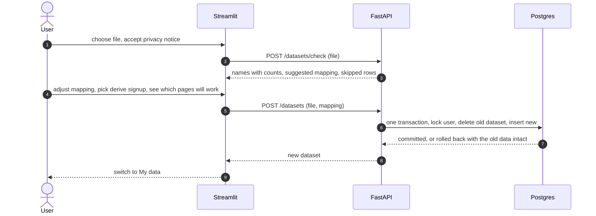

# Phase 6b — Bring your own data (uploads): design

Status: **approved 2026-11-01** (revised after external review; churn scoring changed to per-upload backtesting; trial run passed) · Date: 2026-11-01 · Phase: 6b · Path: architectural (new `datasets` table, migration, dataset-scoped queries and caches, upload endpoints, new UI step)

## 1. Goal and understanding

A signed-in, allow-listed person uploads a CSV of their own product-activity events and sees the same dashboard (Overview, Funnel, Retention, Engagement) plus a churn-risk report for **their file only**. Nobody else can see it. The demo data stays available.

Said by the user: audience is anyone allowed to sign in; uploads come after the dashboard; the churn report on an upload is **trained and tested on that file's own history**, with the simple inactivity rule as a competitor, and is built as the **last, separable task** (this replaces the earlier choice of scoring with the shipped synthetic-data model); CSVs use **fixed columns plus an event-name mapping step**; **one dataset per user**, replaceable and deletable; files with no signup event may use **"first event counts as signup"**.

Not in scope: using the shipped synthetic-data model on uploads, a user-chosen churn horizon (fixed at 14 days for now), per-customer explanations, arbitrary column mapping, several datasets per user, sharing a dataset with another user, saved views, scheduled refresh, non-CSV formats.

## 2. Assumptions

- **A1.** Uploaded data may contain real customer identifiers. It is private to its owner, deletable, never logged.
- **A2.** An upload has no churn labels, but its own history does: "no qualifying activity in the 14 days after a date" can be observed for every past date whose 14 days lie inside the file. That is the same label the shipped model uses, so the same pipeline can train and test on the upload. Results measured this way show the method worked on the file's recent past, not that it will keep working.
- **A3.** The free Supabase tier is small (500 MB shared), so limits are tight (section 5).
- **A4.** The allow-list keeps the user count small; limits still hold per user and globally.

## 3. Decisions

| # | Decision | Why |
|---|---|---|
| D1 | `dataset_id` column on `customers` and `events`; new `datasets` table with an owner. The demo data is dataset 1 (no owner, visible to all allowed users) | Mirrors the saved-reports ownership pattern; no runtime DDL |
| D2 | Uniqueness becomes **per dataset** (`event_id`, `external_customer_id`) | Two users can upload the same ids |
| D3 | Ownership check lives in one module (`db/datasets.py`); a foreign or missing dataset id is a **404** | Same rule as reports |
| D4 | Two calls: **check** (stores nothing) then **import** (with mapping). Both carry the file as a **multipart upload**, not JSON | Server stays stateless and never trusts browser parsing; JSON escaping can inflate a 5 MB file past the body cap and FastAPI's default 422 echoes the offending input |
| D5 | Replace = **one transaction** that deletes the user's old dataset and inserts the new one, serialised by one global `pg_advisory_xact_lock` (transaction-scoped, so it is safe behind Supabase's transaction-mode pooler) | A failed import keeps the old data; the same lock also makes the global-cap check and the insert one atomic step. Imports queue, which is fine at this user count. A repeated replace is harmless, so Retry after a client timeout is safe |
| D6 | "First event counts as signup" **derives a `signup` event** per customer lacking one, at their first mapped event's time (`properties.derived = true`), only when no event is mapped to `signup` | Retention, funnel and churn features all need `signup` (features drop customers without one); no metric code changes |
| D6a | **Left-censoring guard for the derived rule.** A customer who really joined before the file starts gets a derived signup at the file's start, which inflates the first cohort, "new users" and makes `account_age_days` mean "days since the file began". Fix chosen: the check step computes the share of customers whose first event falls in the file's first 7 days; **at 25% or more it shows a red warning and the user must tick "I understand signup dates are approximate"** before the import button works. Afterwards, Overview (new users), Retention (first cohort) and Churn Risk (account age is unreliable) each carry a fixed note saying so. Excluding the first-week cohort from the heatmap is deferred. The threshold was 50% until the trial run: a 10-week slice of the demo data had 45% of customers starting in its first week (about 10% expected if arrivals were even) and the warning stayed silent | Stops the silent misreading without changing metric code |
| D7 | Existing analytics and churn routes gain an optional `dataset_id` query parameter, default demo (1) | Backward compatible |
| D9 | **Churn scoring on an upload is learned from the file itself** (section 5a): weekly cutoffs, features from the 28 days before each, labels from the 14 days after, time-based train/test split with a purge gap, logistic regression against the days-since-last-activity rule on the same test; the better one scores today's customers. The demo dataset keeps the shipped model | The score is measured on the user's own data instead of borrowed from synthetic data; almost all code already exists (`features.make_cutoffs`, `build_features`, `build_labels`, `split_by_cutoff`, `train.make_logistic`, `evaluate.baseline_metrics`) |
| D10 | The fitted model is stored as **plain numbers in JSON** (feature names, scaler means and scales, coefficients, intercept, threshold) on the dataset row, never as a pickle | Loading it cannot run code; deleting the dataset deletes it; inference is a dot product |
| D11 | Churn on uploads is the **last task** and can be dropped without touching the others | The analytics on uploads are valuable on their own and ship first |
| D8 | Whole file rejected if more than 5% of rows are invalid; otherwise valid rows import and up to 20 skip reasons are shown. **Denominator:** rows whose event name is mapped to "ignore" and duplicate rows are left out of both the invalid count and the denominator, so unmapping a noisy event name cannot get a file rejected | One bad row must not block a large file; a mostly broken file must not import silently |

## 4. Data model (migration `0003_datasets`)

- `datasets`: `id` bigint PK · `owner_id` uuid NULL FK to `user_profiles` (NULL = demo) · `kind` text CHECK in (`demo`, `upload`) · `name` text · `source_filename` text NULL · `signup_rule` text CHECK in (`event`, `derived_from_first_event`) · `mapping` jsonb · `mapped_counts` jsonb (rows per our event name) · `customer_count` int · `event_count` int · `data_through` timestamptz NULL · `scoring` jsonb NULL (method, reason, fitted numbers, test metrics; section 5a) · `created_at`. A **partial unique index on `owner_id` where `kind = 'upload'`** allows at most one upload per user. Row 1 is the demo dataset, created by the migration.
- `datasets.owner_id` references `user_profiles` ON DELETE CASCADE (removing a profile removes its upload; deleting profiles is not automated yet).
- `customers.dataset_id` and `events.dataset_id`: NOT NULL FK to `datasets` ON DELETE CASCADE; existing rows backfilled to 1.
- Constraints: replace the global uniques with `unique(dataset_id, external_customer_id)` and `unique(dataset_id, event_id)`; add `unique(dataset_id, id)` on `customers` (required as the target of the composite FK); a composite FK `events(dataset_id, customer_id)` to `customers(dataset_id, id)` so an event can never point at another dataset's customer. Indexes lead with `dataset_id`: `(dataset_id, customer_id, event_timestamp)`, `(dataset_id, event_name, event_timestamp)` and `(dataset_id, id)` on `events` (for the newest-event-id lookup).
- Code that relied on the old global uniques changes in the same step: `ingestion.py` uses `on_conflict_do_nothing(index_elements=["dataset_id", "event_id"])` and upserts customers on `["dataset_id", "external_customer_id"]`.
- RLS on and `anon`/`authenticated` grants revoked for `datasets`, as in `0002`. The RLS test is extended.
- Downgrade is allowed only when no upload exists (otherwise it raises).
- `POST /events` and the loader script write to dataset 1 explicitly.
- Size, measured on the local demo load (42,847 events, 2,000 customers): events cost about 289 bytes per row and customers about 249, indexes included. The new column and index add an estimated 30 to 40%. So 300,000 uploaded events is about 87 MB today and roughly 120 MB with the new indexes, about a quarter of the 500 MB tier before Supabase's own tables. The global cap of 300,000 events stands; re-measure on the real project before deploy.

## 5. API

| Method | Path | Purpose |
|---|---|---|
| GET | `/datasets` | Demo plus the caller's own: id, kind, name, counts, data_through, `capabilities`, `signup_rule` |
| POST | `/datasets/check` | Multipart form: `file`; stores nothing; returns rows, customers, time range, event names with counts, suggested mapping, skipped rows (count, first 20 reasons), the timestamp assumption |
| POST | `/datasets` | Multipart form: `file`, `mapping` (JSON string), `derive_signup`, `acknowledge_approximate_signup`; imports and replaces; returns the dataset |
| DELETE | `/datasets/{id}` | Own upload only; demo or someone else's is a 404 |
| POST | `/datasets/{id}/score` | Own upload only; (re)runs section 5a and stores `scoring`; used after import and as Retry if scoring failed |
| existing | analytics, churn | `?dataset_id=`; a dependency checks visibility (demo or owned), else 404 |

Limits (constants in one module): request body at most 5.5 MB (411 without Content-Length, 413 over; checked before parsing) and the file part at most 5 MB, read in chunks and stopped at the limit; the app adds `python-multipart`; the Streamlit uploader sets `server.maxUploadSize = 5` in `frontend/.streamlit/config.toml` so oversize files are refused in the browser; these routes use a 422 handler that never echoes the input (a validation error cannot send the user's data back or into logs); at most 50,000 event rows; at most 10,000 customers; at most 50 distinct event names; a global cap on uploaded events (default 300,000), over which import returns 409 "storage full" (checked inside the same import lock as the insert, so two simultaneous imports cannot both pass). Auth is `current_user`, as on other routes. The 5 MB, 50,000-row and 10,000-customer figures are provisional until the real-database timing below.

**CSV rules.** UTF-8 (BOM allowed), comma-separated, header row, columns matched case-insensitively and trimmed: required `customer_id`, `event_name`, `event_timestamp`; optional `event_id`; other columns are ignored and never stored. IDs and names are trimmed and at most 100 chars. Timestamps are ISO-8601; one with no zone is treated as UTC and the check says so; a timestamp is rejected if in the future (5 min skew) or before 2000-01-01, the same bounds as `POST /events`. Without `event_id`, one is derived: a hash of customer, mapped name and timestamp, **with no occurrence number**, so identical rows are duplicates and are dropped (event logs normally mean the same event twice at the same instant is a repeat, not two events). Duplicate `event_id`s, supplied or derived, keep the first and are counted as duplicates, not as invalid rows. Importing the same file twice in a row gives identical counts.

**Mapping.** `{their_name: our_name or null}` with `our_name` in `EVENT_NAMES`; many-to-one is allowed; at least one target must be in `QUALIFYING_EVENTS`, else the import is refused. The suggestion matches by normalised name (lower case, spaces and hyphens to underscores). `derive_signup` is accepted only when nothing maps to `signup`.

**Capabilities** (computed from `mapped_counts` and `signup_rule`): Overview and Engagement always; Retention needs `signup` (mapped or derived); Funnel needs every step in `metrics.FUNNEL_STEPS` (read from there, not listed here), else it names the missing steps; Churn depends on `scoring.method` (section 5a) and needs a signup too; it shows the existing empty state if no customer is eligible.

## 5a. Churn scoring on an upload

Runs after the import commits, in its own transaction (a failure leaves the dataset intact with `scoring.method = "failed"` and a Retry). Steps:

1. **Cutoffs.** `features.make_cutoffs` over the upload (weekly, midnight UTC, each with a fully observed 14-day label horizon), keeping at most the latest 26 to bound training time.
2. **Split.** `features.split_by_cutoff` with **2 test cutoffs** (the shipped model uses 4; 2 lowers the history needed). Train cutoffs end at least 14 days before the first test cutoff, so no training label overlaps the test period.
3. **Features and labels.** `build_features` and `build_labels`, unchanged, on the upload's events.
4. **Fit.** `train.make_logistic(seed=42)` on the training rows.
5. **Compete.** On the test rows compute PR-AUC and ROC-AUC for the model and for the rule (`evaluate.baseline_metrics`, rule = days since last activity, at risk at 7 days or more). The model wins only if its PR-AUC beats the rule's by at least 0.02; otherwise the rule wins. Either way both results are stored and shown.
6. **Score now.** At the dataset's default cutoff (as for the demo), eligible customers are scored by the winner. Model: probability and class at the stored threshold. Rule: days since last activity and an at-risk flag; the list shows days, not a probability, and the histogram buckets days.

Floors (constants), checked in order:

| Result | Condition | Page shows |
|---|---|---|
| `logistic` or `inactive_rule` (checked) | the split succeeds; at least 200 test rows; at least 20 churners and 20 non-churners in the test; at least 20 churners in training | the winner's ranking plus "Measured on your history: n test rows, k churners, PR-AUC model vs rule" |
| `rule_unchecked` | not enough for a test, but at least 28 days of history (one feature window) | ranking by days since last activity, labelled "not checked on your data: too little history" with what is missing |
| `unavailable` | less than 28 days | a fixed message naming the missing history |

Roughly 9 weeks of history are needed for a checked result (28-day window, 14-day horizon, a train cutoff, a 14-day purge gap and 2 test weeks). The page always shows the counts behind any number. "Churn" here means inactivity for 14 days, not cancellation, and the page says so.

Training time is part of the budget: the plan's scoring task measures it on a 50,000-event, 10,000-customer file and keeps it under 20 s, reducing the cutoff count if needed.

**Trial run (2026-11-01, local, throwaway script).** The steps above ran on five versions of the demo file. Full file (180 days, 2,000 customers): checked, rule won (PR-AUC 0.821 vs 0.820), 1.4 s. Last 10 weeks with derived signup: checked, rule won (0.809 vs 0.796), 0.4 s. Last 6 weeks: no split possible, `rule_unchecked`. 150 customers: floors not met (135 test rows), `rule_unchecked`. Five copies (10,000 customers, 214,235 events): 2.7 s. Every run passed the leakage check (train horizons close before the first test cutoff); the JSON model matched scikit-learn exactly; the stored model is about 1.3 KB. On this data the rule always wins because the generator's churn is inactivity itself.

## 6. Flow

UI: a sidebar **Data** selector (Demo data, My data), default Demo. An **Upload data** page (template download, notice, check, mapping, replace confirmation, import, delete). A banner that follows the selection: demo keeps the current text; My data says "Your uploaded data: <filename>, private to you". Pages whose capability is missing show a fixed message naming what is missing. A 404 for the selected dataset falls back to Demo with a notice. On the Churn Risk page for My data, the evaluation block shows the backtest on the user's own history (method used, test rows, churners, PR-AUC and ROC-AUC for the model and for the rule) or the reason it could not be checked; the synthetic model's metrics never appear for an upload. Retention and Funnel carry a note when the signup is derived (see D6a). The upload notice says: "Your file is kept until you delete it or your access is removed. Do not upload personal data you are not allowed to share." The dataset selector is checked against a fresh `GET /datasets` on every rerun (like `/me`), so a deleted or replaced dataset id is never read from cache.

## 7. Caches

- Frontend `data.py`: every cached call keys on `dataset_id` and the signed-in user id (new parameters on each function); the `_api` argument stays excluded.
- Backend churn-list cache: for the demo dataset the key becomes `(1, model_version, cutoff, max(events.id) for dataset 1)`; an upload never changes (a replace creates a new id), so its key is `(dataset_id, scoring fitted-at timestamp, cutoff)` with no per-request query; re-scoring changes the timestamp. Bounded to 4 entries (oldest evicted).
- **On delete or import** the backend evicts that dataset's cache entries (the scored rows hold external customer ids) and the acting session calls `st.cache_data.clear()`. Other browser sessions of the same user cannot resurrect deleted data because of the fresh dataset check above. Tests assert both caches are empty after a delete.
- `latest_event_id`, `data_through`, `resolve_customers`, `customer_external_ids` and every analytics repository function take `dataset_id`.

## 8. Security and privacy

| Risk | Control | Test |
|---|---|---|
| Reading or deleting another user's dataset | `db/datasets.py` owns the check; every route uses it; 404 | two-user tests on every route |
| Event or customer crossing datasets | composite FK and dataset-scoped uniques | a direct insert is refused |
| `POST /events` writing into a user dataset | writes target dataset 1 only | test |
| Resource exhaustion | size and row caps, global cap, per-user lock, 5% rule | boundary tests |
| Partial import or lost data | single transaction | a forced failure keeps the old dataset |
| Leaking rows in logs or errors | skip reasons carry row numbers and codes, never values; fixed error messages | log-capture test |
| Stale cache across datasets or users | keys include dataset and user | frontend and backend tests |
| Check endpoint parses up to 5 MB with no rate limit | accepted behind the allow-list; size caps and chunked read bound the cost | boundary test; revisit in Phase 7 |
| Deleted data lingering in caches | eviction on delete and import; fresh dataset check | both caches asserted empty |
| Validation error echoing the user's file | custom 422 handler without input | test with a malformed upload |
| Loading a stored model runs code | fitted numbers stored as JSON, applied by a dot product; no pickle or joblib for uploads | test that `scoring` holds only numbers and names, and inference matches scikit-learn |
| Overstating churn accuracy | backtest on the file's own later weeks; floors; counts always shown; the rule competes and wins ties | floor and winner-selection tests |
| Personal data | notice on the upload step; delete really deletes (cascade); no extra columns stored | delete test counts rows |

## 9. Failure behaviour

Invalid CSV, missing columns and over-limit files return fixed 4xx messages with a reason code. Database unavailable: the existing 503. The import can be slow on a cold database: the frontend timeout is 60 s with a Retry that re-sends the file from session memory; a replace that already committed after the client timed out is safe to repeat.

**Import time.** Measured locally: loading the 42,847 demo events through the current insert path took 11.5 s (about 13 s extrapolated to 50,000). A cold free-tier instance adds latency per round trip and a cold-start delay, and the transaction also deletes up to 50,000 old rows. The first plan task therefore times a 50,000-row import (batched `executemany` inserts, `COPY` if needed) against a scratch schema on the real project, with the owner's approval since it writes to Supabase, and checks it against the pooler's statement timeout. The row, byte and customer limits above are set from that result.

## 10. Testing

- Migration up and down on seeded data.
- Every route with two users and a foreign id; the demo dataset cannot be deleted.
- Atomic replace under a forced failure; concurrent imports by one user (one wins, none partial).
- Caps: rows, bytes, customers, names, global.
- The 5% rule at and just above the limit.
- Timestamp bounds and zoneless handling.
- Mapping validation, including a missing qualifying event.
- Derived signup (retention, funnel and features all see it).
- `event_id` derivation and duplicates, including importing the same file twice in a row (identical counts).
- Delete and replace empty both caches; a deleted dataset id is never served from cache.
- The left-censoring warning at 25% and just below, and the acknowledgement gate.
- The 5% rule with ignored and duplicate rows excluded from the denominator.
- `ingestion.py` conflict handling is per dataset (the same `event_id` in two datasets both import).
- The 422 handler never echoes the file.
- Cache keys on both sides.
- Capabilities for several mapping shapes.
- Hand-checked metrics on a small uploaded file equal the same events loaded as demo.
- Frontend: selector, banner, notices, 404 fallback.
- Scoring: on a hand-built file where the churners are the customers who go quiet, both methods rank them first; a second hand-built file where churn depends on something other than recency (so the model must beat the rule by more than the margin) proves the model-wins path, which the synthetic demo data never exercises; the purge gap leaves no training label inside the test period; the 0.02 margin picks the rule on a tie and the model on a clear win; each floor at and just below its limit gives the right method; the JSON model's probabilities equal scikit-learn's to 1e-9; a scoring failure leaves the dataset intact and Retry works; the synthetic model's metrics never appear for an upload; the rule view shows days, not a probability.

## 11. Plan outline (for the plan document)

0. Timing spike: 50,000-row import on a scratch schema on the real project (with approval); set the limits.
1. Migration `0003` (including `unique(dataset_id, id)` and the new indexes), models, `db/datasets.py`, dataset-scoped repositories, `ingestion.py` conflict targets, `POST /events` pinned to dataset 1.
2. `dataset_id` on analytics and churn routes, visibility dependency, churn cache key and bound.
3. CSV parsing and the check endpoint.
4. Import (mapping, derived signup, transaction, caps), list and delete endpoints.
5. Frontend: data selector, dataset-keyed caches, banner and notices.
6. Frontend: Upload data page.
7. Churn on uploads: section 5a (scoring service, JSON model, floors, score endpoint), the churn route and page for uploads, timing check. Separable: if dropped, Churn shows "not available for uploaded data yet".
8. Docs, `scripts/purge_uploads.py --older-than N` (manual admin script, by import date), progress, whole-branch review, real run-through with three files: one with no signup event, one with a timestamp column without a timezone, and one that starts mid-history (to see the D6a warning).

## 12. Open points

- Limits (5 MB, 50,000 rows, 10,000 customers) are provisional until task 0 times a real import. The 300,000-event global cap is backed by the size measurement in section 4 and is re-measured before deploy (Phase 7).
- The 0.02 PR-AUC margin and the floors (200 test rows, 20 per class) are judgement calls; revisit them after the real run-through.
- No automatic expiry in 6b. The upload notice says so, and a manual purge script covers the gap. Automatic expiry can wait for Phase 7.
